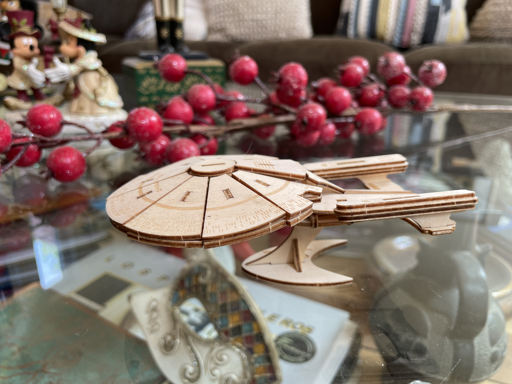

Have you heard the old saying that you can't teach an old dog new tricks? Well, it's not true. Of course you can learn, and a lot.

I, at least, have learned tons this year, and from people much younger than me.

My father used to say that we are always learning, that even at the moment of our death we learn about one of the greatest mysteries of our existence.

Some people say it has to do with neuroplasticity. The theory is that the younger you are the more neuroplasticity you have, and you lose it as you age.

What is neuroplasticity?

It's the ability of our neurons to modify their state, so that our brain creates new structures and neural connections, depending on the conditions of the environment it develops in.

You know: fixed, boring environment, little neural development. Varied, stimulating environment, lots of neural development.

When I was little I developed strabismus. Family legend has it that the ophthalmologist told my parents I didn't need surgery, that it was enough to cover one eye and stimulate me with games so I would develop the muscles of the eye that drifted. I don't know if that's true, but my mother says she spent hours with me playing with colored toys, blocks and that kind of thing.

I also had lots of Legos and similar toys. And now my puzzles take shape in lines of code. Maybe those early stimuli formed my analytical and spatial ability, which is useful for developing logical-mathematical skills and, consequently, the ability to program.

The thing is, ever since I was a kid I've had a fondness for multidimensional puzzles. From the old Meccano sets to Legos.

It so happens that this year [my brother](http://www.ricardodiaz.org) sent me a gift, a laser-cut wooden model kit, which after falling into my hands turned into this:

I built it on Christmas night itself. For an hour I was a kid putting this puzzle together. Everybody went to bed and I stayed up in silence assembling a wooden replica of the Enterprise D.

Thank you, brother, not so much for the physical gift as for the moment.

The perfect nerd experience.

Now let's get back to neural plasticity.

When our brain creates a neural pathway, it can disappear if it isn't reinforced. It's just like those paths we open through the grass: the more we walk along it, the more the ground settles and clears, and we've made a trail.

So the best way to keep our neural plasticity is to keep producing new trails, which in the end are new experiences.

I know people who say they don't like trying new foods, or “strange foods”, who don't dare try flavors other than the ones they already know. Or people who won't risk taking different routes, or meeting new people, or interacting with those who think differently, or even questioning their personal beliefs. There you have people who are starting to atrophy.

The opposite of plasticity is rigidity.

They say conservatives want everything to stay as it is (that's a good definition of conservative, actually). And while it's a legitimate position, because what they're after is stability and security, in the long run it causes a kind of social neural atrophy. The same thing happens in organizations: there are people who don't want new things tried. They want to leave everything as it is, because that's how they've operated for years: “that's how things have always been done around here”.

Every time you're rigid you're shutting out a pile of opportunities. Your mind atrophies, your ability to face new challenges shrinks. I've been fortunate that when I've felt that starting to happen to me I've made drastic changes in my life, and that I've always been supported in them.

In every change I've met amazing, very intelligent people who have challenged me and with whom I've learned “new tricks”. But that's luck, too. Although some say our nose guides us toward our own kind, or as Hermann Hesse put it:

> “When someone who truly needs something finds it, it is not chance that provides it, but he himself. His own desire and his own need lead him to it”

Over time I've realized that I'm an optimist. I believe there are far more positive things than negative ones in this world. The catch is that to get the positive ones we have to take risks, stop doing things the way we were doing them, stop being rigid and conservative, and instead be more open and trusting.

We've always seen the image of the rigid person as someone old, atrophied, pessimistic, who sees threats in everything and in everyone who isn't like them.

Plasticity means dealing with those differences, persuading rather than imposing. Listening and understanding rather than criticizing or belittling. In politics, for example, there are people who call themselves progressive or liberal and yet are the first to belittle ordinary people for not voting the way they do. That's rigidity too. In fact there's a label, here in Chile at least, used to put down whoever shows more plasticity in politics: *amarillo*, "yellow". Rigidity isn't a flaw of the conservative right alone. There are rigid people on every side.

A person with a high degree of neural plasticity keeps learning their whole life. I'm sure it's not true that plasticity declines with age. I think neural plasticity tends to get lost when we refuse to keep developing it.  

A new year is starting, and I have several resolutions, as I suppose you do. But I think the key to succeeding at those resolutions is not being rigid. Plasticity may be what helps us face this changing world, so full of threats and yet brimming with opportunities.

I hope this little reflection on plasticity helps you reassess your resolutions, and that you open up to the new opportunities life puts in front of you.

I want to take the chance to thank those who support me on [Ko-fi](https://ko-fi.com/lnds), and to invite those who don't to join in. Next year I intend to publish a new book and your support will help make that happen. To support me, all it takes is buying me a coffee on Ko-fi by pressing this button:



Happy New Year, live long and prosper.

