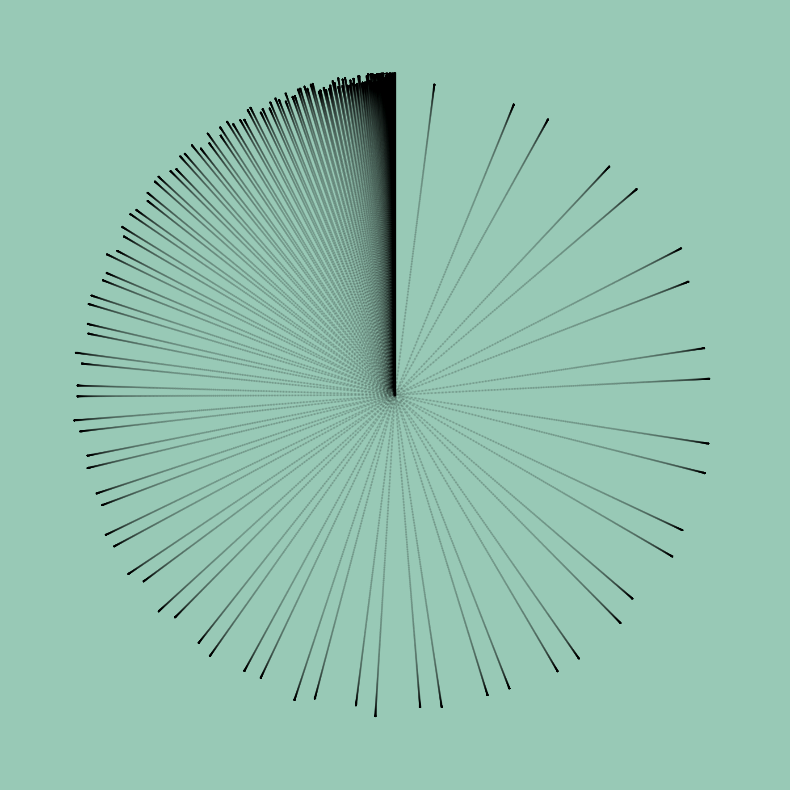
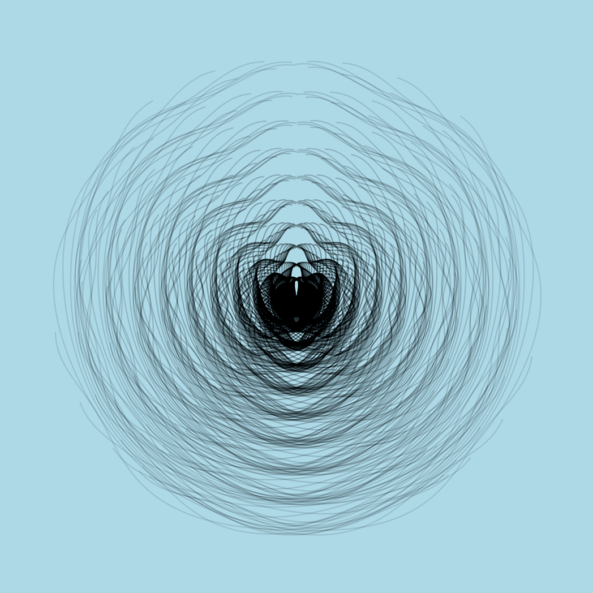

The pleasure Hermann Göring must have felt contemplating the painting "Christ and the Adulteress", by Johannes Vermeer, can only be compared to the chill he must have felt handing over the nearly two million guilders he paid for it (almost seven million of today's dollars).

We don't know whether he ever hung the painting in some hall or office, or whether he got to show it to the Führer himself. Maybe he meant to give it to him, or sell it to him. The fact is that the work was hidden in a salt mine in Austria.

When the Allies recovered the many works stolen by the Nazi regime, they traced the purchase of "Christ and the Adulteress" back to **Han van Meegeren**, a celebrated art dealer and retired painter. This gentleman's special trait was his knack for finding unknown works by the Dutch master. Years earlier, in 1937, he had managed to sell "The Supper at Emmaus" for 520,000 guilders (about 4 million of today's dollars), a painting that a tycoon ended up donating to the Rotterdam museum.

Van Meegeren was accused of collaborating with the Nazis, for selling this work to Hitler's second-in-command himself. Facing the prospect of the death penalty, the accused decided to confess that he was in fact an art forger, that he had painted the works in question himself. With that he became a sort of national hero, by admitting he had fooled the Nazi boss and charged him a ridiculous sum of money.

During the trial Han van Meegeren demonstrated his forgery technique to the court by painting another picture, showing in this way how he had fooled the experts who authenticated the works.

A fascinating story, told very entertainingly in the 2019 film [«The Last Vermeer»](https://www.imdb.com/title/tt8337320/), directed by Dan Friedkin, which I recommend you watch.

What we don't know, and what the story doesn't tell us, is what Göring felt when he handed over such a sum. Pride? Vanity? A sense of superiority? Power? Knowing he held in his hands a unique, original work, never seen before because it had been lost for so many years.

What did Van Meegeren feel as he watched the face of Hitler's number two? Clearly he must have had a smile on his face, maybe some brief mocking gesture. Laughter on the inside, and perhaps joy. I don't think there was any patriotism in it. He was a bon vivant addicted to luxury and worldly pleasures, far removed from such ideas, though not unaware of what was going on. All the same, he must have felt contempt for the barbarian soldier, ignorant of art, who was trying to dress himself up as elegant by looting or buying all the art he could find.

That's how barbarians are when they pile up a lot of wealth and no culture. They need to acquire what they can't understand or deeply appreciate.

At least Göring had something he could hide in a salt mine.

I think of those who buy an [NFT](https://es.wikipedia.org/wiki/Token_no_fungible). And of those who produce them. The Görings and Van Meegerens of our time. Though in a way they are all new barbarians, merely speculating with the surpluses they have generated out of nothing.

In a recent article, the cryptographer and creator of [Signal](https://signalfoundation.org), Moxie Marlinspike, lays bare the problem behind the NFT.

In ["My first impressions of web 3"](https://moxie.org/2022/01/07/web3-first-impressions.html) he shows us how he is able to create an NFT that behaves differently depending on where it is displayed. The images below prove it.

This image is shown on the NFT marketplace [Opensea](https://opensea.io):

The next one is the version seen by anyone who wants to buy it on [Rarible](https://rarible.com):

And finally, what whoever buys the NFT will see in their *"wallet"*:

With this he shows us very clearly that the NFT is not what some people think it is. A way to own "art", or whatever, uniquely. Because the NFT has a fundamental flaw in its implementation, according to what Marlinspike explains in his article:

> Instead of storing the data on-chain, NFTs instead contain a URL that *points to* the data. What surprised me about the standards was that there’s no hash commitment for the data located at the URL. Looking at many of the NFTs on popular marketplaces being sold for tens, hundreds, or millions of dollars, that URL often just points to some VPS running Apache somewhere. Anyone with access to that machine, anyone who buys that domain name in the future, or anyone who compromises that machine can change the image, title, description, etc for the NFT to whatever they’d like at any time (regardless of whether or not they “own” the token). There’s nothing in the NFT spec that tells you what the image “should” be, or even allows you to confirm whether something is the “correct” image.

In other words, we can publish an image on a site, of, I don't know, let's say a photograph, then sell the NFT and afterwards take the site down.

Now, what they are actually selling is the NFT, the Non Fungible Token, which is nothing more than a record on the blockchain that holds a URL, and only that: a string of characters that corresponds to the URL.

Strictly speaking they can say they haven't scammed you, because they sold you the token, that record on the blockchain, not the image, which, after all, anyone can download.

Those who understood this well realized it's an easy way to make money from their works without parting with them. Like, for example, John Lennon's son, [who will auction NFTs of his private collection of Beatles memorabilia](https://www.elfinanciero.com.mx/espectaculos/2022/01/26/julian-hijo-de-john-lennon-subastara-nft-de-su-coleccion-personal-de-the-beatles/).

I wonder how history would have gone if instead of the painting Göring had bought the NFT of "Christ and the Adulteress". That way the painting would never have left Holland, and who knows whether any court would have bothered to hold a trial over such a ridiculous transaction.

