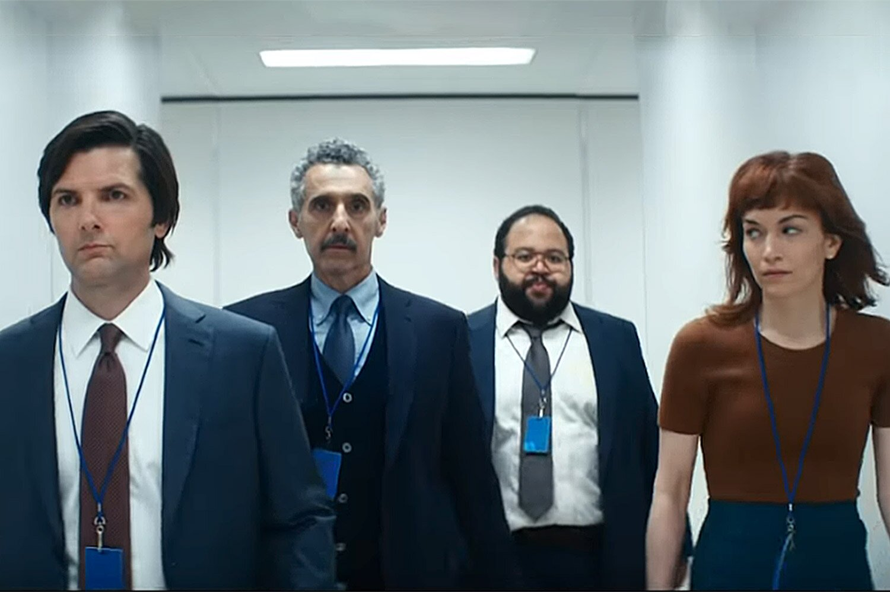

We thought the pandemic and the lockdowns were taking us into a dystopian world, but the experience made us realize that being locked up for two or more hours in a car or on the subway, and spending more time at the office than with our families, was the real dystopia.

I remember that years ago a colleague, or maybe a manager where I worked, said it was important to look after the work climate and keep a harmonious environment because, after all, we spent more time at work than in our own homes.

And if you ran workplace climate surveys, one of the workers' most heartfelt aspirations was the need to balance family life with work life.

More evidence that the way we were living was all wrong.

How did we get there?

If you look at human history, work and home life were always close together. The blacksmith had his workshop at home, just as the farmer lived on the land he worked; even the teacher lived in the school or near it. Our society grew more complicated, and it was industrialization, and later computerization, that sent huge numbers of people traveling from their homes to their workplaces.

But now we've realized that many jobs don't require that commute, and we discovered we could live and work in the same place.

We discovered that the division was completely unnecessary. Sure, communications technology had to mature, and the pandemic had to force "digital transformation" on us abruptly, but the conclusion is obvious.

Of course this doesn't apply to every job yet, but it should keep growing over time; after all, the day will come when a lot of hard labor is done by robots.

It isn't free of problems either. Not everyone is in a position to set up adequate infrastructure at home for remote work. On top of that, many companies haven't helped, offering no support for the extra expenses this new situation brings, such as covering the internet and utility costs that go up at home.

It's true that I'm writing this from a privileged position. I live in a house, and since my older kids no longer live with me I've been able to turn a room into my office, something that was off-limits to me for a long time. I also work in an industry where this is entirely possible and natural. What's more, I work on a team spread across different parts of the globe.

I think that having taken the step, we should go further. We should go back to what seems to me most natural for human beings.

I know of a colleague who has worked from different cities around the country during this pandemic. I myself have split my time between my house in Santiago and the property we built in the south. We've become nomads. Or maybe we've gone back to being nomads, just as we were thousands of years ago.

People talk about hybrid work and remote work as options that should be offered to workers. I think that at this point, after the experience has been tested and proven, they are more than that. They should already be rights. What's more, I believe the concept we should aspire to is this idea of nomadic work. Work free of schedules, free of physical ties and, if you push me, free of hierarchies, but maybe I'm getting carried away with my revolutionary vision.

# Severance

The Apple TV+ series "Severance" offers an interesting and disturbing dystopian vision. It takes reality to its almost obvious conclusion.

In the series, workers undergo a surgical procedure that splits their personality. That way, when they enter their workplace, all memories of their family and social world disappear. They even develop another personality that only functions at work; they've become "innies", perfect workplace drones carrying out apparently absurd tasks.

But human beings, with their hunger to know and to understand the meaning of their lives, always come through in the end, and that's where the conflict that drives this TV show is born.

There are several deep and interesting ethical and philosophical dilemmas in the series, starting with the fact that these workers have voluntarily chosen to undergo the severance procedure.

You know what distresses me most about watching that series?

That if people were given the chance to live completely separate lives in their work world and their personal life, many would take it.

We live in interesting times, but we have the chance to redefine our relationship with work; we've discovered that things we thought impossible no longer are. Maybe more than redefining, what we're doing is recovering. It seems to me that this idea of becoming nomads again is the most natural thing in the world; it may be the key to recovering our freedom, our sense of personal growth, and it's probably even better for the environment.

A while ago I saw a sentence go by on Twitter that said more or less this: "we're losing remote work and we're doing nothing to defend it". And it's true.

I'm not against companies having offices and making them available to their employees. That's fine by me, especially because not everyone is able to create a suitable environment for working at home.

Nor can everyone move to a second home, or be a nomad with the means to rent a place to stay anywhere.

But perhaps companies should provide the space for their workers to do their jobs properly. Still, it should also be possible to promote the option of working from home, or in places closer to home. As I said at the beginning, spending two hours in a tin can on wheels was the real dystopia.

The solution can't be let's all go back to the office and go back to polluting and ruining our quality of life. We have to show that we learned something from this time.
