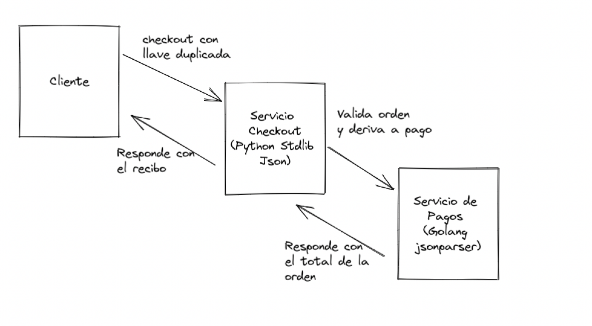

In his talk for "El Congreso del Futuro", Chile's annual science and ideas conference, the renowned expert [Bruce Schneier](https://www.schneier.com/) gives us six lessons on cybersecurity:

1.  Most software is poorly written and insecure. And the main reason behind this is economic. Nobody invests the time or resources to write quality software.
2. The internet was never designed with security in mind. The internet was an experiment, a network for academic and research purposes, which, thanks to the push of a few Silicon Valley entrepreneurs at the end of the last century, became the platform where much of today's e-commerce and social networks developed. But in its beginnings nobody considered that it would be used for these purposes, and so it lacked a lot of security infrastructure. That has improved over time, but there's still a way to go.
3. The extensibility of systems enables new attacks. Software is extensible, and we often allow that extensibility in order to gain future flexibility; the flip side of this property is that it can be used to exploit vulnerabilities.
4. Complexity makes attack easier than defense. Software is ever more complex and interconnected, and those complexities only keep growing. The attack surface, the number of exposed points that can fail or be used to attack us, increases every day.
5. There are new vulnerabilities in the interconnections. And this is what I'm going to talk about in detail in this article. But it's obvious that in a more interconnected and complex world the job of defending those interconnections grows.
6. Attacks keep getting better, easier and faster. Today it's possible to automate these attacks, even to outsource them. There are more and more cybercriminals with better tools for carrying them out.

For a couple of years now I've been teaching a course on web and mobile application security for a cybersecurity master's program. Along with teaching the classics of the subject, I explain to my students some principles that have shaped modern software development. In some cases, these fundamentals have had consequences that turn into vulnerabilities we need to understand, or at least be aware of, so we can take the proper precautions.

One example of these principles is the one known as "backward compatibility", which consists of respecting old implementations of a piece of software, including their flaws or bugs. Let's look at this through one of the cases I present to my students.

### The case of the duplicate keys

These days it's very common to use REST APIs that rely on JSON to encode their messages.

Consider the following JSON object:

```javascript
{
"orderId": 10,
"cart": [
   {
    "id": 1, 
    "qty": 10
   },  
   {
    "id": "3", 
    "qty": -1, 
    "qty": 1
   }
]}
```

It looks pretty normal, except for the fact that the `cart` key contains an array whose second element has the `qty` key duplicated.

This object is valid and allowed. The problem is how the different JSON parsers out there interpret this situation.

Let's look at this in more detail. If we have this object:

```javascript
obj = {"test": 1, "test": 2}
```

 What will we get with the expression `obj["test"]`?

 It depends. Some JSON parser implementations will return the first value, that is, 1. But others will legitimately return 2. And still other implementations will raise an error.

The IETF JSON specification, RFC 8259, says:

_An object whose names are all unique is interoperable in the sense that all software implementations receiving that object will agree on the name-value mappings. When the names within an object are not unique, the behavior of software that receives such an object is unpredictable. Many implementations report the last name/value pair only. Other implementations report an error or fail to parse the object, and some implementations report all of the name/value pairs, including duplicates._  
  
_JSON parsing libraries have been observed to differ as to whether or not they make the ordering of object members visible to calling software. Implementations whose behavior does not depend on member ordering will be interoperable in the sense that they will not be affected by these differences._

So the specification doesn't deal with this problem, perhaps so as not to break compatibility with versions already out there. The result, therefore, depends on the implementation.

To see how this can affect the security of an application, we'll take an [example developed by Jake Miller](https://bishopfox.com/blog/json-interoperability-vulnerabilities).

### Exploiting this vulnerability

Consider the following situation: we have a client that interacts with a REST service in charge of the checkout of a purchase order. This service is written in Python with the Flask framework and uses the language's standard library to process the JSON message. The job of this service is to validate that the quantities requested in the shopping cart are within a valid (positive) range; it then forwards the order to a payment service, and once the payment is processed it kicks off shipping of the products and generates a receipt.

The payment service is written in Go, and uses a high-performance library to parse JSON messages (buger/jsonparser).

The following diagram summarizes the flow between these services, in the case where the client is sending a message with a duplicate key:



The HTTP request sent by the client is the following:

```
POST /cart/checkout HTTP/1.1
...
Content-Type: application/json

{
    "orderId": 10,
    "paymentInfo": {
        //...
    },
    "shippingInfo": {
        //... 
    },
    "cart": [
        {
            "id": 0,
            "qty": 5
        },
        {
            "id": 1,
            "qty": -1,
            "qty": 1
        }
    ]
}
```

The problem is that Python's JSON parser interprets duplicate keys by taking the last value, while the Go implementation takes the first value when keys come duplicated.

In other words, given the message just shown, for the second item the Python service will take 1 as the requested quantity, and the payment service will take the value -1.

On top of that, since the first service is in charge of validating the quantities, the second service assumes the message carries the proper (positive) values and therefore blindly runs the calculations.

What this scenario produces is that the response to the request above is the following:

```
HTTP/1.1 200 OK
...
Content-Type: text/plain

Receipt:
5x Product A @ $100/unit
1x Product B @ $200/unit

Total Charged: $300
```

So with this message we've obtained 5 products worth a total of $700 for the price of $300.

If you're interested in the technical details, you can go through the source code of this lab provided by Jake Miller: https://github.com/BishopFox/json-interop-vuln-labs/tree/master/lab1 and simulate this scenario on your own.

## Conclusions

The example I've shown you backs up several of Bruce Schneier's claims. A lot of code is poorly written, and there are vulnerabilities in the interconnections as a product of that poorly written code. Add to that the complexity of current implementations, which increases the opportunities for attack. The scenario shown is one that can come up in a microservices-based environment, for example.

Another way to look at it has to do with the origin of this problem. A bug introduced in the first JSON parsers in JavaScript, which allows duplicate keys, was left unresolved in the specifications that formalized this data interchange format (RFC 8259).

The result is a domino effect. A flaw in one implementation gets perpetuated and opens up flanks in the interconnection of services. In the example, the two services interpret the same message differently, which opens a serious security hole.

Jake Miller gives several pieces of advice on how to mitigate this vulnerability and shows other examples of errors in the JSON specification that can also be used to hit services that use it. I recommend reading that article: https://bishopfox.com/blog/json-interoperability-vulnerabilities

Regardless of this particular case, what I want you to take away is that computer security is an ever harder challenge. There are many details like the one shown here.

Another problem in this example is that the implementer of the second service trusts that the first service will take care of validating that the quantities have correct values. That assumption creates the whole problem in this case. A defensive programming style would force us to implement the same validations in the second service, even if they seem redundant, because whenever we have two services talking to each other we must suspect that the messages they exchange can be altered one way or another. In this case the message isn't altered, but we see that the JSON specification allows ambiguous messages to be created.

Besides, it's certain that the uses of the second service can be extended (Schneier's lesson 3), and it's likely that new services wanting to use the payment service won't perform the validations it is expecting.

It's impossible to build systems one hundred percent free of vulnerabilities and flaws that affect the security triad: Confidentiality, Integrity and Availability. What we can do is manage these risks, and so it's important to know the limitations of the tools we use to develop software. We have to be aware that things can fail in the worst possible way, and build our systems accordingly.

To wrap up, here's Schneier's full talk:


