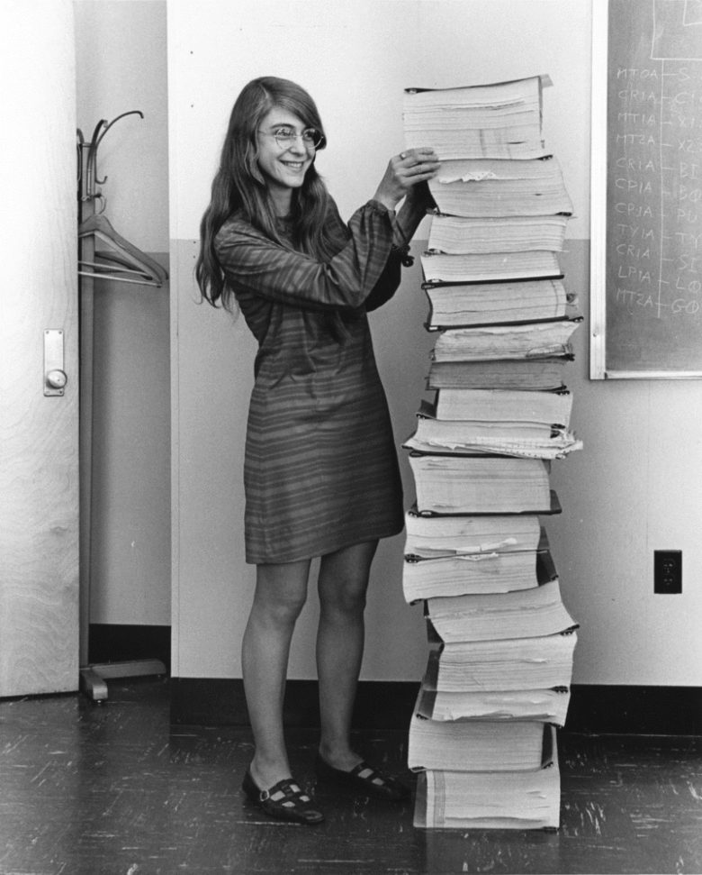
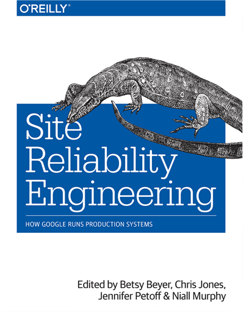
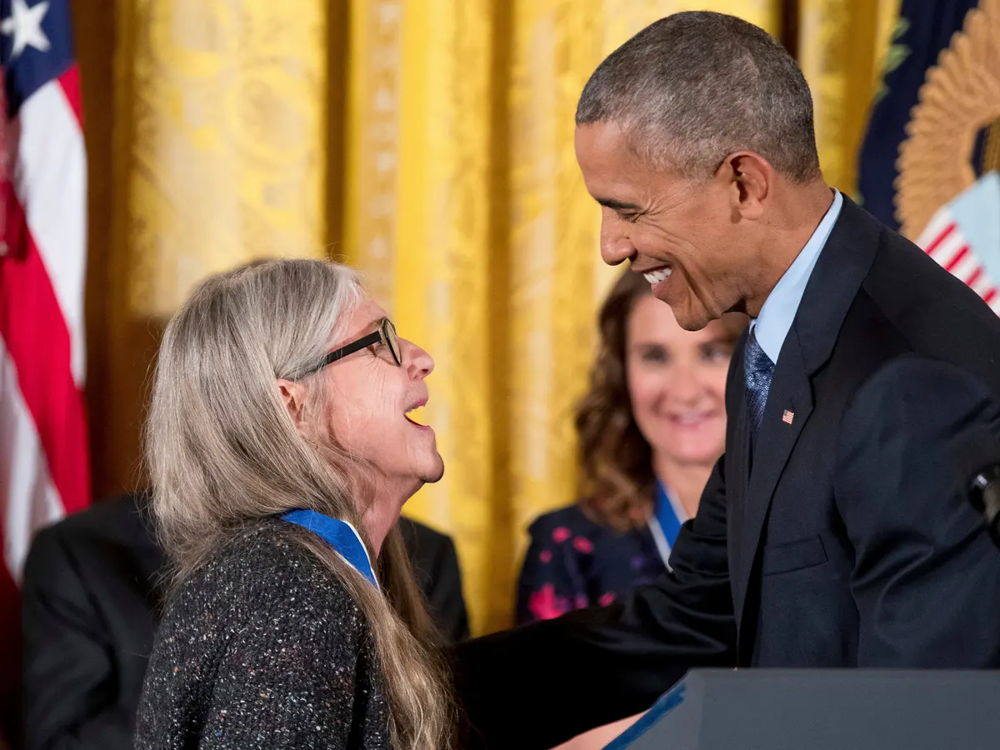

A few weeks ago I was a guest on the [podcast "Había una vez un Algoritmo"](https://algoritmo.buzzsprout.com) ("Once Upon an Algorithm"), hosted by [Camilo Chacón Sartori](https://camilochs.github.io/web/) (
you can listen to the interview at this link: https://algoritmo.buzzsprout.com/758831/10810042).

During the interview Camilo asked me about a figure from the computing world whom I admire. And after weighing several alternatives, I expressed my growing admiration for [Margaret Hamilton](https://en.wikipedia.org/wiki/Margaret_Hamilton_(software_engineer)).

I found it curious that Camilo said he didn't know much about her, but the truth is that almost certainly anyone who knows something about Margaret Hamilton knows it because of this photograph:

In the picture we see her standing next to the printed listing of the Apollo source code. This photo has been shared thousands of times on social media, but I suspect people don't dig much deeper than the fact that she programmed that code (of course she wasn't alone; she led the software team that did it).

Those who have dug a little deeper may know that she is one of the people credited with originating the term "software engineering"[^1]. On that subject she says:

> When I first came up with the term, no one had heard of it before, at least in our world. It was an ongoing joke for a long time. They liked to kid me about my radical ideas. It was a memorable day when one of the most respected hardware gurus explained to everyone in a meeting that he agreed with me that the process of building software should also be considered an engineering discipline, just like with hardware. Not because of his acceptance of the new 'term' per se, but because we had earned his and the acceptance of the others in the room as being in an engineering field in its own right.

But Margaret Hamilton's contribution runs much deeper than many suspect.

A write-up prepared by NASA, on the occasion of an award it gave her for her contributions to the Apollo software, says:

>"The Apollo flight software was one of the earliest successful and most significant developments of flight software as we know it today. It was a pioneering effort which performed exceptionally for Apollo. The concepts developed became the building blocks for modern "software engineering", a term coined by Ms. Hamilton, and immediately found use beyond Apollo on Skylab and Shuttle. Her concepts of asynchronous software, priority scheduling, software reuse, and man-in-the-loop decision capability such as priority displays, became the foundation for ultra-reliable software design.
>
>Many examples can be cited of successful implementation on Apollo. The most important example is from Apollo 11. On July 20, 1969, three minutes before the Eagle's touchdown on the moon, the software overrode a command to switch the flight computer's priority processing to a radar system whose 'on' switch had been manually activated due to a faulty written operations script provided to the pilot. If the software override had not been active, pre-programmed, tested and simulated, the LEM landing might have been aborted or the LEM could have crashed on that fateful day, possibly killing the astronauts and jeopardizing the manned space flight program. 
>    
> The 40,000-line LEM code[^2] and its matching code for the service and command modules were written under contract to Charles Stark Draper Labs under the direct design control of Ms. Hamilton. Her unique ideas included: using priority displays, establishing hard requirements on the engineering of all components and subsystems to eliminate interface errors with the flight software at the systems level, debugging all components and testing before assembly, and simulating every conceivable situation at the systems level before releasing the code. This made it possible to identify potential anomalies and resulted in ultra-reliable code. No software bug was ever found on any manned space flight Apollo mission. She demanded that the flight code be designed to work right the first time: “There was no second chance.” Apollo lives on today continuing to impact the modern world in part through the many innovations created and championed by Ms. Hamilton.

With the experience she gained and the ideas she forged on the Apollo project, Hamilton founded two software companies, "High Order" in 1976 and "Hamilton Technologies" in 1986. Her methodologies have been used successfully in various U.S. government projects.

In the preface of the book ["Site Reliability Engineering"](https://sre.google/sre-book/table-of-contents/), edited by a group of Google engineers, they pay tribute to her by declaring that Hamilton would be the first SRE (Site Reliability Engineer):

> We like to think that Margaret Hamilton, working on the Apollo program on loan from MIT, had all of the significant traits of the first SRE. In her own words, "part of the culture was to learn from everyone and everything, including from that which one would least expect."
>
> A case in point was when her young daughter Lauren came to work with her one day, while some of the team were running mission scenarios on the hybrid simulation computer. As young children do, Lauren went exploring, and she caused a "mission" to crash by selecting the DSKY keys in an unexpected way, alerting the team as to what would happen if the prelaunch program, P01, were inadvertently selected by a real astronaut during a real mission, during real midcourse. (Launching P01 inadvertently on a real mission would be a major problem, because it wipes out navigation data, and the computer was not equipped to pilot the craft with no navigation data.)
>
>With an SRE's instincts, Margaret submitted a program change request to add special error checking code in the onboard flight software in case an astronaut should, by accident, happen to select P01 during flight. But this move was considered unnecessary by the "higher-ups" at NASA: of course, that could never happen! So instead of adding error checking code, Margaret updated the mission specifications documentation to say the equivalent of "Do not select P01 during flight." (Apparently the update was amusing to many on the project, who had been told many times that astronauts would not make any mistakes—after all, they were trained to be perfect.)
>
> Well, Margaret's suggested safeguard was only considered unnecessary until the very next mission, on Apollo 8, just days after the specifications update. During midcourse on the fourth day of flight with the astronauts Jim Lovell, William Anders, and Frank Borman on board, Jim Lovell selected P01 by mistake—as it happens, on Christmas Day—creating much havoc for all involved. This was a critical problem, because in the absence of a workaround, no navigation data meant the astronauts were never coming home. Thankfully, the documentation update had explicitly called this possibility out, and was invaluable in figuring out how to upload usable data and recover the mission, with not much time to spare.
>
> As Margaret says, "a thorough understanding of how to operate the systems was not enough to prevent human errors," and the change request to add error detection and recovery software to the prelaunch program P01 was approved shortly afterwards.

In 2016 Barack Obama awarded her the Presidential Medal of Freedom, the highest civilian honor given in the United States.
"She symbolizes the generation of unsung women who helped send humankind into space," the president said when he presented her with the medal.

When she was asked what lessons from that era programmers can apply today[^3], her answer was:

> We’ve recently seen systems where a plane crashed and the pilot had no idea what was going on. It’s a good idea for the pilot to know what their options are! Also, what became apparent with Apollo – though it is not how it worked – is that it is better to define your system up front to minimise errors, rather than producing a bunch of code that then has to be corrected with patches on patches. It’s a message that seems to have gone unheeded – in this respect, software today is still built the way it was 50 years ago.

[^1]: According to this NASA write-up: https://www.nasa.gov/pdf/251093main_The_NASA_Heritage_Of_Creativity.pdf. The term is also attributed to Anthony Oettinger and Barry Boehm.
[^2]: Lunar Excursion Module, called Eagle in the case of Apollo 11.
[^3]: Interview in The Guardian: https://www.theguardian.com/technology/2019/jul/13/margaret-hamilton-computer-scientist-interview-software-apollo-missions-1969-moon-landing-nasa-women
