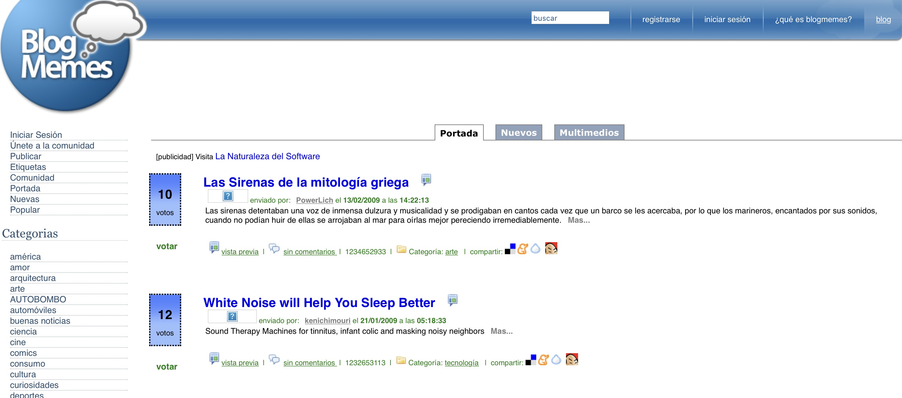
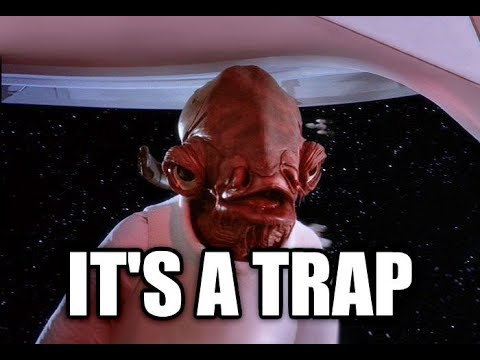

I got up today fully in the mood to write. Almost four months have gone by since [the last entry](/en/blog/lnds/2022/07/24/margaret-hamilton-the-first-sre/) on this blog.

So I headed to the terrace to sit down and write, and the first problem was that our table was taken up by soil, flowerpots and succulents my wife is getting ready. OK, no room, I'll set up somewhere else.

After making coffee and procrastinating on Twitter for a while, only to end up reading something about Jupiter's Trojan asteroids, I remember that my idea was to catch up on the blog, so I open the lid of my laptop.

I go to the folder where I keep my blog's texts and run the usual routine:

    git pull --rebase
    hugo -w server

And instead of having my blog running the way it should, Hugo answers with a horrible error that ends with this text:

    fatal: failed to expand user dir in: '~/.gitignore'

What the *!&/$%! happened now!

Almost an hour lost on Google searches, forums, GitHub pages, and a failed reinstall of Hugo and [Wowchemy](https://wowchemy.com), only to find this, in an [obscure reference in a GitHub thread](https://github.com/phpro/grumphp/issues/105):

    Maybe it's also easier to just brew install git ?

Hmmmm.

It turns out I installed the macOS Ventura update, and the developer tools typically end up a mess after this kind of update. So we reinstall Xcode and see if the classic option to install the developer tools is there; maybe that solves the problem...

But no. That didn't work. So I try the advice posted by [@veewee](https://github.com/veewee) in 2016 in the thread I mentioned:

    brew install git

Of course, after that Hugo started working like a charm.

Thanks [@veewee](https://github.com/veewee), wherever you are.

At last I could get Hugo going:

    hugo new --kind post post/2022-11-05-lo-que-hemos-olvidado-sobre-internet

    code .

And at last I could start writing.

Now, more than a few of you will wonder why all the complication.

To understand it, I have to explain how I publish my blog.

1. The content of my blog is in [Markdown](https://es.wikipedia.org/wiki/Markdown) format, or to be more precise, in a variant supported by [Hugo](https://gohugo.io)
2. Markdown files are plain text files, but they have a markup language that lets you set up their appearance in a relatively simple way. It's like [LaTeX](https://lnds.net/blog/lnds/2008/01/14/latex/), but much simpler (and in my opinion just as powerful, maybe more)
3. [Hugo](https://gohugo.io) is the tool I use to convert these Markdown files into HTML files that can then be published anywhere. Hugo is what's known as a static site generator, and it's a very useful content manager because this approach gets you the best possible performance on a website with static content (like news sites, blogs, or company information pages). If your content isn't going to change much it's the best alternative, far better than other [CMSs](https://es.wikipedia.org/wiki/Sistema_de_gestión_de_contenidos) like [WordPress](https://wordpress.com) or [Liferay](https://www.liferay.com) (the horror; seriously, don't use Liferay, do it for the planet)
4. My idea is to manage my content myself. I don't want to use platforms that are free or that lock you in, like Medium, for example.
5. Since the content of my blog is text files, I can version it with Git, and that way I can publish it anywhere; in particular I have it on GitHub in this repo: <https://github.com/lnds/lnds-site>. If one day I get mad at GitHub, I move all my content somewhere else. Actually I already do that, because I have a copy that is automatically backed up on GitLab: <https://gitlab.com/lnds/lnds-site>
6. So my content is backed up, it's public, and it isn't tied to the whims of the owners of Medium, for example, or of any other platform where I might host it.
7. Now there's the problem of [hosting](https://www.hostinger.es/tutoriales/que-es-un-hosting). Since my blog's traffic volume is low, I use the services of [Netlify](https://www.netlify.com). If this site's traffic ever exploded (not going to happen, dream on, Edo), I can move up to the paid service. And if the owners of Netlify turn nasty, I switch providers or install the content on an Nginx anywhere.

What I get in the end is real freedom (not the kind libertarians talk about; I mean the real one).

# Digital freedom

Freedom in the digital world belongs to those who have command of the technology.

Today I use Hugo, but if I want I can build my own HTML generator (it's not that hard, if you know how). In fact, at one point I wrote my [own blogging platform](https://github.com/lnds/prosa-blog-server), and this blog was hosted there for at least a couple of years.

Given time, anyone who knows how to program and has a handle on the basics of managing web infrastructure can create anything. And that gives them freedom, an enormous freedom and power in the digital world.

Everyone else has to use services.

The good thing is that there are lots of free services (in English the word "free" covers both "free of charge" and "free as in freedom"). But as an old internet adage says: "if the product is free, then you are the product".

So the modern programmer has this great freedom, and with it a great power, but as Uncle Ben said: "with great power comes great responsibility".

# Social aggregators

The year was 2005 and we were all publishing blogs. That led to the rise of a special kind of application, the "social news aggregators", sites dedicated to curating and spreading content published on web pages.

It was the time of applications like [Slashdot](http://slashdot.org), created by [Rob Malda](https://en.wikipedia.org/wiki/Rob_Malda), or [Digg](https://digg.com) by [Kevin Rose](https://lnds.net/blog/lnds/2006/01/23/una-entrevista-con-el-fundador-de-digg-com/).

These were a sort of primitive social network, or proto-social-networks. Facebook existed, but it was still restricted to universities and wasn't exactly the same kind of thing.

The idea was to share interesting content: people posted a short text and the link to the site they wanted to promote. Through a mix of votes and selection algorithms, the content made its way to the front pages.

Inspired by those sites, in December 2005 I launched [BlogMemes](https://lnds.net/blog/lnds/2005/12/07/blog-memes/). That project was in turn the evolution of another project called [America Escribe](http://web.archive.org/web/20060319054125/http://www.americaescribe.org/).

Around that time another site also emerged in Spain, called [Menéame](https://www.meneame.net).

I devoted several months of my free time to BlogMemes, and the site got to more than 40,000 users, if I remember correctly. But I didn't have the time to keep at it, and a site like this takes a lot of work.
I discovered that building a "social" site on the internet is a big responsibility.

Just to name the most critical aspects, I had to worry about things like:

- Spammers
- People posting sites that could be harmful or illegal
- Users fighting because they felt their site deserved more promotion
- Hacks
- Etc.

I didn't have the heart to go on, so I decided to sell the site (for a ridiculous sum) and the right to use Blogmemes to a French contributor to the project, and I walked away from it.

# Social networks

It also happened that people started abandoning their blogs because they decided to migrate to Facebook, and later to Twitter.

"Microblogging" became the fashion, and blogs were left to a few enthusiasts.

And that's how the problems began.

Because when you let a platform manage your content it stops being yours; it belongs to the platform.

Many bloggers told me they got more attention on Facebook, so they started favoring that platform.

The problem is that getting more attention is a trap.

If you don't believe me, you can read this interesting Wikipedia article titled ["Pivot To Video"](https://en.wikipedia.org/wiki/Pivot_to_video). That idea, fed by Facebook, led to layoffs and the downfall of several media outlets, which sacrificed ownership of their content for the sake of more attention, above all from the younger generations.

This idea that people don't want to read anymore, or that they want short or visual content, is really a product of the trends exploited by companies like Facebook.

Today a few people are horrified because Elon Musk is taking control of Twitter. The businessman says he's doing it in the name of free speech, when what he really wants is to control the discussion, eliminating everything he doesn't like. And if they can control the conversation, it's because we've let them.

Every time you put your content on a platform you're handing it over to that platform, be it Medium, Facebook or Twitter. Your tweets are no longer yours, and neither are the posts on your wall.

Still, you can't avoid having a presence on those networks; after all, if you manage your own content, as I do, you still need people to find it. That was the idea behind the social news aggregators, but that system failed; only a few are still useful, because they're consumed by narrower communities (I'm thinking of [Hacker News](https://news.ycombinator.com)).

Maybe the solution is to go back to the origins of the web, and remember that the Net is a [world of ends](https://lnds.net/blog/lnds/2008/06/30/un-mundo-de-extremos/):

  When it comes to the Net, a lot of us suffer from **Repetitive Mistake Syndrome**. This is especially true for magazine and newspaper publishing, broadcasting, cable television, the record industry, the movie industry, and the telephone industry, to name just six.

  [...]
  
  "The Internet interprets censorship as damage and routes around it," [John Gilmore](http://www.toad.com/gnu/) famously said. And it's true. In the long run, Internet radio will succeed. Instant messaging systems will interoperate. Dumb companies will get smart or die. Stupid laws will be killed or replaced. But then, as John Maynard Keynes also famously said, "In the long run, we're all dead."

  All we need to do is pay attention to what the Internet really is. It's not hard. The Net isn't rocket science. It isn't even 6th grade science fair, when you get right down to it. We can end the tragedy of Repetitive Mistake Syndrome in our lifetimes — and save a few trillion dollars' worth of dumb decisions — if we can just remember one simple fact: the Net is **a world of ends**. You're at one end, and everybody and everything else are at the other ends.

  Sure, that's a feel-good statement about everyone having value on the Net, etc. But it's also the basic rock-solid fact about the Net's technical architecture. And the Internet's value is founded in its technical architecture.

  Fortunately, the true nature of the Internet isn't hard to understand. In fact, just a fistful of statements stands between Repetitive Mistake Syndrome and Enlightenment...

  1. The Internet isn't complicated
  The idea behind the Internet in the first place was to harness the awesome power of simplicity — as simple as gravity in the real world. Except instead of holding little rocks tight against the big round rock, the Internet was designed to hold smaller networks together, turning them into one big network.

  The way to do that is to make it easy easy easy for the networks to send and receive data to and from one another. Thus, the Internet was designed to be the simplest conceivable way to get bits from any A to any B.

  2. The Internet isn't a thing. It's an agreement

  When we look at utility poles, we see networks as wires. And we see those wires as parts of systems: The phone system, the electric power system, the cable TV system.

  When we listen to radio or watch TV, we're told during every break that networks are sources of programming being beamed through the air or through cables.

  But the Internet is different. It isn't wiring. It isn't a system. And it isn't a source of programming.

  The Internet is a way for all the things that call themselves networks to coexist and work together. It's an inter-network. Literally.

  What makes the Net inter is the fact that it's just a protocol — the Internet Protocol, to be exact. A protocol is an agreement about how things work together.

  This protocol doesn't specify what people can do with the network, what they can build on its edges, what they can say, who gets to talk. The protocol simply says: If you want to swap bits with others, here's how. If you want to put a computer — or a cell phone or a refrigerator — on the network, you have to agree to the agreement that is the Internet.

  3. The Internet is stupid

  The telephone system, which is not the Internet (at least not yet), is damn smart. It knows who's calling whom, where they're located, whether it's a voice or data call, how far the call reaches, how much the call costs, etc. And it provides services that only a phone network cares about: call waiting, caller ID, \*69 and lots of other stuff that phone companies like to sell.

 The Internet, on the other hand, is stupid. On purpose. Its designers made sure the biggest, most inclusive network of them all was dumb as a box of rocks.

  The Internet doesn't know lots of things a smart network like the phone system knows: Identities, permissions, priorities, etc. The Internet only knows one thing: this bunch of bits needs to move from one end of the Net to another.

  There are technical reasons why stupidity is a good design. Stupid is sturdy. If a router fails, packets route around it, meaning that the Net stays up. Thanks to its stupidity, the Net welcomes new devices and people, so it grows quickly and in all directions. It's also easy for architects to incorporate Net access into all kinds of smart devices — camcorders, telephones, sprinkler systems — that live at the Net's ends.

  That's because the most important reason Stupid is Good has less to do with technology and everything to do with value...

  4. Adding value to the Internet lowers its value

  Sounds screwy, but it's true. If you optimize a network for one type of application, you de-optimize it for others. For example, if you let the network give priority to voice or video data on the grounds that they need to arrive faster, you are telling other applications that they will have to wait. And as soon as you do that, you have turned the Net from something simple for everybody into something complicated for just one purpose. It isn't the Internet anymore.

  5. All the Internet's value grows on its edges

  If the Internet were a smart network, its designers would have anticipated the importance of a good search engine and would have built searching into the network itself. But because its designers were smart, they made the Net too stupid for that. So searching is a service that can be built at one of the million ends of the Internet. Because people can offer any services they want from their end, search engines have competed, which means choice for users and astounding innovation.

  Search engines are just an example. Because all the Internet does is throw bits from one end to another, innovators can build whatever they can imagine, counting on the Internet to move data for them. You don't have to get permission from the Internet's owner or systems administrator or the Vice President of Service Prioritization. You have an idea? Do it. And every time you do, the value of the Internet goes up.

  The Internet has created a free market for innovation. That's the key to the Internet's value.

The problem is that we've forgotten these things and we've let a few control access to the ends.

The text above was written in 2003 by Doc Searls and David Weinberger, and you can find it in full, translated into Spanish, here: <https://lnds.net/blog/lnds/2008/06/30/un-mundo-de-extremos/>

In that text the authors say there are three basic rules of the internet that give it its power:

- No one owns it
- Everyone can use it
- Anyone can improve it

And that, unfortunately, is what we've forgotten.

    git add content resources
    git commit -m "lo que hemos olvidado sobre internet"
    git push
