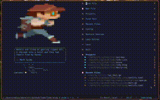
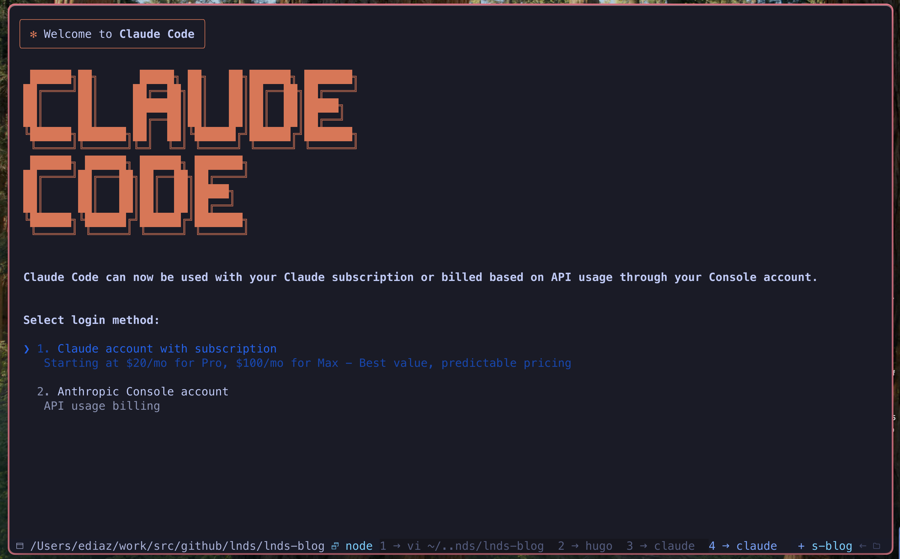

+++
date = '2025-07-27T18:46:02-04:00'
draft = false 
title = 'In the beginning was the command line'
slug = 'in-the-beginning-was-the-command-line'
tags = ['AI', 'software engineering']
serie = 'IA en mi flujo de trabajo'
categories = []
featured = false
projects = []
+++

In his essay "In the Beginning... Was the Command Line" (1999), Neal Stephenson argues that the GUI is a layer of abstractions wedged between humans and the way computers actually operate.

One GUI that's very popular among programmers is the IDE, the Integrated Development Environment,
as we call it. It exists because programming kept getting more and more complicated.
Especially with the rise of frameworks, and worse, with enterprise development
patterns. A classic example is an enterprise Java application.

For almost 20 years I held an executive role as a deputy development manager,
and when I left for a startup (Cornershop) as an architect,
I started working with code far more often than I was used to.
Until then my interaction with code had been the odd personal project,
some program I wrote for my blog, or a small project for the company
I worked for.

Programming is my passion, but I have to confess I was pretty rusty,
which became more obvious when I went to work at Uber.
So I had to relearn a lot of things, and improve my practices as a software engineer.

That's how, 3 years ago, I made the decision to make the terminal my main
work tool. I wanted to boost my productivity, and that's when
I went back to one of my
[favorite text editors](/en/blog/lnds/2012/04/05/the-best-text-editor-in-the-whole-wide-world/),
but in its new incarnation: [NeoVim](https://neovim.io/).

There are many reasons why using the terminal helps you improve your productivity
as a programmer. On top of that, not having to leave the terminal to edit your code
is a very powerful reason to use a terminal editor like NeoVim. But I won't try
to talk you into it; if you're happy with Visual Studio Code or whatever you use, fine.
Just consider how many minutes you lose each day switching context between windows.
Once you weigh that, you start to see the terminal and NeoVim from another perspective.

## Bringing AI into my workflow

This is the first in a series of articles on how I've adapted my workflow
to bring in Artificial Intelligence.
These days I use AI for a lot of things, but I'll start
by telling you how I ended up using it to help me program.

If this series does well, I'll tell you how I'm using it in other activities,
in other aspects of my profession and in my personal life.

Curiously, several friends and colleagues believe I don't use AI,
or that I'm against using it.
Mainly because of some of my comments on LinkedIn.

The truth is I've never been against using it. What happens is that I've been observing,
experimenting with, and conscientiously studying this new technology before
adding it to my toolbox.

I know there's a lot of enthusiasm and high expectations about its abilities, especially from people who don't understand how it works and operates.

When I studied for my master's degree, I took a course on data science, and there
I was lucky enough to learn from great academics and computer scientists
who are experts in these subjects.

The rise of transformers and their capabilities didn't surprise me at all,
because I had the background to understand their architectures and read up on these advances.

But software engineering is my specialty and my passion, so I had to understand
to what extent the advances in AI are going to affect the way we build software.

We have to go beyond "vibe coding" and understand not only what we have available,
but also assess how it affects us, and how what's coming will affect our processes.

I'm going to tackle these topics over several articles, following more or less this
publishing plan:

- An introduction, this article you're reading
- My experiences using AI to program
- The economics of AI, where I'll comment on the cost of this technology
- The change we need to make in our development processes
- Ideas on how to train new software engineers in a post-AI world
- The future of software engineering and of our profession

## Claude Code is my copilot

I assume you got the joke.

When Claude Code showed up I realized it was what I'd been looking for.
You can program without having to leave the terminal and without touching the editor.
It has good integration with several IDEs, but originally there wasn't one for NeoVim.
Fortunately there's a
[pretty good plugin](https://github.com/coder/claudecode.nvim), developed using
this very tool.

Why don't I use GitHub Copilot, or Cursor?

There's broad consensus in the community that GitHub Copilot has fallen behind.
What bothers me about it, and about other integrations, is the autocomplete mode.
Remember that AI "hallucinates" and won't always give you
the best solution; it also takes "strange" paths, and that gets really annoying
when you're working in a mode where you and the machine are sharing the editing
of the code.

That's why Cursor and other editors end up implementing a chat interface.

Chat mode is the most natural way to interact with AI. So is talking to it,
although that's something I can't get used to; I prefer typing the
instructions on a command line in the chat.
The people at Anthropic understood this very well, in my opinion.

Since I don't like leaving the terminal, Claude Code is ideal for my workflow.
But also, of the models I've used, I consider Sonnet very good at
programming tasks.

But AI has its limits and risks, and those are what I intend to talk about in the next
article in this series.

If you like the publishing plan, I invite you to subscribe to my
[Newsletter](https://Newsletter.lnds.net/) (in Spanish), where
I'll let you know when the next articles in this series come out.

Your comments also encourage me to keep going and to learn. I'm sure many
of you use AI in a different way and have had experiences different
from mine; let's all share these impressions.
