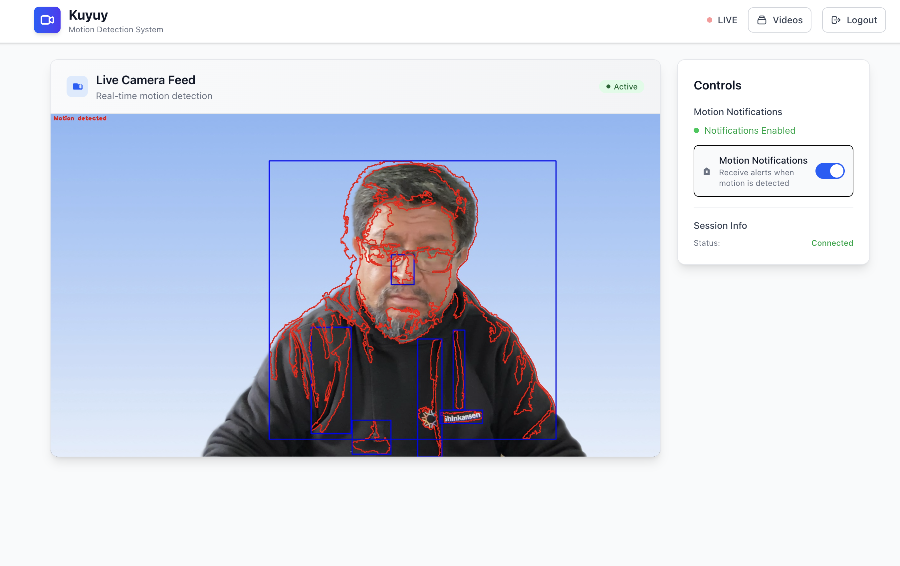

+++
date = '2025-07-29T08:13:42-04:00'
draft = false 
tags = ['AI', 'Claude Code', 'agents', 'vibe coding', 'software engineering']
title = 'To vibe or not to vibe, that is the question'
slug = 'to-vibe-or-not-to-vibe'
+++

Last year I taught an online workshop at a bootcamp on advanced algorithms and data structures.

It was three classes, and in one of them I talked about streaming algorithms.
When I say "streaming"
you surely think of something like Netflix or YouTube, but no,
what I talked about was back pressure techniques, sketching algorithms,
that kind of thing.

But I couldn't leave my students without showing them how video streaming is done,
so I wrote a [simple program in Go](https://github.com/lnds/algoritmos-streaming/tree/main/stream-video)
that did "video streaming", and showed it to them.
That program was the seed of a personal project.

The problem I wanted to solve is streaming from a video camera,
and detecting motion using that camera.
The motivation is being able to keep an eye on a house that sits empty part of the year.

For hardware I had a Raspberry Pi and an HD webcam.
That's how the Kuyuy project was born.
According to Google Translate, kuyuy is movement in Quechua.

Programming in my free time, I managed to write a program that captures the video
and streams it, and I added rudimentary motion detection
using Go and a library based on [OpenCV](https://opencv.org/).
In a few hours I had something that met
the goal. The program also notified me of movement using [Ntfy](https://ntfy.sh/).

All good, but it needed a more decent interface,
and that's how I used Claude Code
for the first time. Fully in vibe coding mode. I kept feeding it prompts to create
the web user interface. And I really liked the result. Here are some screenshots.

Kuyuy isn't ready yet, but I'll release it as an open source project
before the end of the year, and I'll announce it on this blog and in my newsletter.

## Vibe coding

This was the first time I used something similar to the
concept defined by Andrej Karpathy,
and I must confess it was amazing.



That said, in this case there was a foundation and a clear plan on my part,
which helped me guide the AI effectively.

This experiment convinced me that using AI with the experience of
a senior engineer is the way to go. Because I spotted some problems with
vibe coding that an inexperienced user doesn't consider:

- Security: it's the most obvious one and the one people argue about the most. Code
created by AI can have vulnerabilities, and by default the AI doesn't think about that,
but it can be controlled, and that's where the programmer's experience comes in.
- Maintainability: if you don't give it guidelines on how to code, with practices like
unit and integration tests, linting, etc., the AI creates low-quality code.
- Architecture: the AI's proposals are sometimes weird.
I know that a "senior engineer" is really a cranky engineer who has
learned the hard way that there are things that work in practice,
and things that look like a good idea in the book but aren't in the real world.
At this point in time, AI is a kind of junior engineer,
but more obliging and somewhat scatterbrained.

My second personal project using Claude Code was a failure.
For a while now I've been using a tool called [Doing](https://github.com/ttscoff/doing/wiki),
which lets me keep a daily work log (something I recommend for improving
your personal performance and not forgetting the things you've done).

Doing is fine, but this utility has some bugs and
decisions I don't like, and it's also written in Ruby (the horror),
so I didn't want to clone the repo to modify it to my needs
(yuck, touching Ruby code, no, no, no).

So I started another vibe coding session with Claude.
I was interested in using Rust with [RataTUI](https://ratatui.rs/),
a crate for building [TUI applications](https://en.wikipedia.org/wiki/Text-based_user_interface),
one of the requirements of my application, so I asked the AI to use this
package.
My idea was to make a Doing clone with a more attractive interface
in the terminal.

To keep the iterations under control I asked it to create unit and integration tests
following the most accepted practices in Rust.

But that's where I discovered my big mistake: **not worrying about context**.

## Context is everything

It turns out Claude tries to run tests
by running the program, so they're destructive tests.
In my case, it was operating on the application's log file.
So when I tried the application, my file was gone.

So I asked it to apply mocks in the unit tests, hoping
it wouldn't destroy the files. Since I was in _vibe_ mode, I didn't worry
about the architecture the AI was implementing, and it turned out
to be a disaster.

That's when I decided the AI had to refactor the code, but it was already too late.
I tried adding TUI documentation, especially on how to test applications
built with this framework, and it only got worse.
The tests took a long time, and it started
adding tons of [flaky tests](https://www.jetbrains.com/teamcity/ci-cd-guide/concepts/flaky-tests/),
which on top of that stepped on each other, which led it to implement mutual
exclusion in the code. Everything got complicated and I spent more time trying to
fix the tests than making progress on features.

So it's super important to give the AI a lot of context about what you want to do.
I had that in the case of Kuyuy, but in this second experiment I was
very lazy about it. Trying to fix the architecture along the way
didn't work, so I made the decision to abandon the project and
start from scratch.

This time I gave it the link to the original Doing repo, specified better
what I wanted to do, and we created a phased plan to clone the
application's behavior.

Since Doing is a [cli](https://en.wikipedia.org/wiki/Command-line_interface), each command has its help; for example,
you can run `doing help tags` and you get the help on how
the `tags` command works in doing.
So in each phase I asked Claude to use this technique
so it would understand how to implement each command.
I also paid more attention to the architecture.

This new version handles the command as a specialized entity, an object if you like,
that can be used both in the cli and in the tui.

This made it possible to improve testing and refactoring.

At one point I ran [clippy](https://doc.rust-lang.org/clippy/usage.html)
and found out that Claude is a fan of creating functions
with lots of arguments (some with more than thirty!).
That's a big code smell
and shows that we're probably not creating useful intermediate
entities, or that certain abstractions are missing.

I decided not to be too harsh, but I did demand that it refactor those functions,
which, thanks to the tests, could be done in a few extra minutes.

For comparison, the previous version, which I consider a failure and threw away,
took me about 12 hours over 10 days, and I barely implemented 25%
of the functionality. The new one I started yesterday; before writing these
lines I've invested 3 hours, and 8 of the 10 planned phases
are already implemented.

## Trust, but verify

Claude Code is an extremely powerful tool, but it can cost you dearly
in the long run if you don't keep up good practices.

AI has a limited context, and you have to make good use of it.
You need to help it, but not overload it. The limitations it currently has
force you to act strategically and tactically when programming.
But it's always been that way, right? Right???

Vibe coding may be fine for a demo, a prototype, but that code
is probably going to be unmaintainable, and probably not very scalable and insecure.

Use AI as an aid, but keep the code it produces under control. It's scatterbrained;
it forgets that it has to update the tests, or that it has to add some.

But it can be managed, and once you master it, it helps you a lot to be productive.

So far I've talked about how I've used AI in personal projects, but
I haven't told you how I use it at work. A topic I'll get to in the
third chapter of this series.

For now I'll leave you with my project: [Daily-Log](https://github.com/lnds/daily-log),
which you're welcome to use, and let me know if it works for you.

I also invite you to share this post with your colleagues and friends, and to sign up
for my [newsletter](https://newsletter.lnds.net/) (in Spanish) to support my work.
It's free, but there's also a paid version you can subscribe to if you feel like it.

Thanks for reading. I look forward to your comments; share your experience programming with AI.
We're all learning, and sharing makes all of us grow.
