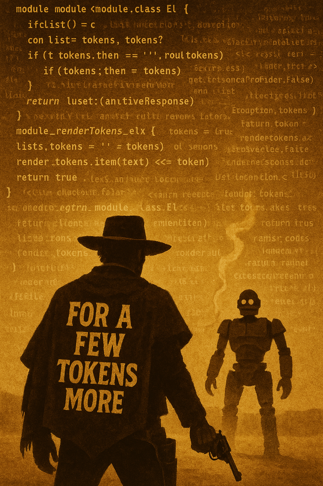
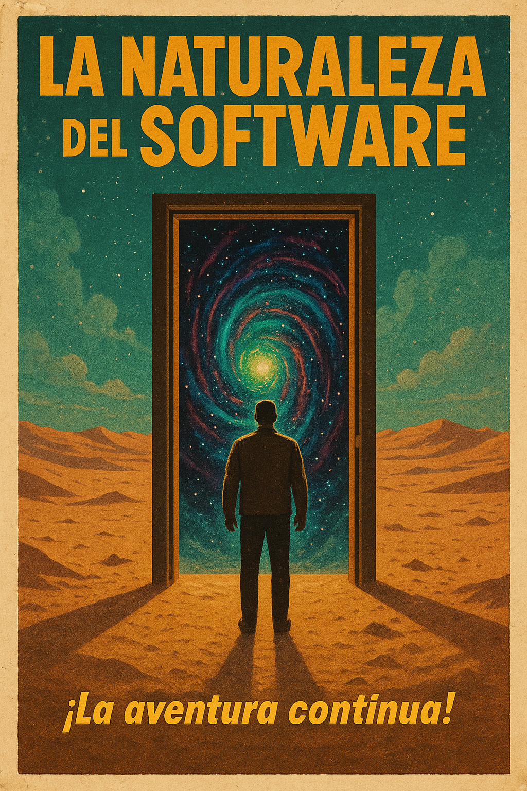

+++
date = '2025-08-01T08:36:43-04:00'
draft = false
title = '20 years'
slug = '20-years'
+++

This blog turns 20 today.

On August 1, 2005, I published [the first official post](/en/blog/lnds/2005/08/01/developing-software-is-like-making-a-movie/) of La Naturaleza del Software (The Nature of Software).

It was the blog boom. Social networks were still a few years away from showing up and ruining our digital lives.

There aren't many of us left in Chile who still keep a personal blog. And if I'm not mistaken, along with [Alejandro Barros's](https://www.alejandrobarros.com/), this is one of the oldest blogs in our country.

It's true that over the last couple of years I moved a lot of my writing to my [Newsletter](https://newsletter.lnds.net), but I never thought of abandoning this space. I just hadn't made the time, and I didn't have the motivation to keep writing either.

That has changed. I'm very motivated, and you can tell: this week I've published five articles, counting this one. The first four are about my experience bringing AI into my work.

If you're interested in reading them, the series consists of the following articles:

- [In the beginning was the command line](/en/blog/lnds/2025/07/27/in-the-beginning-was-the-command-line/)
- [To vibe or not to vibe, that is the question](/en/blog/lnds/2025/07/29/to-vibe-or-not-to-vibe/)
- [For a few tokens more](/en/blog/lnds/2025/07/30/for-a-few-tokens-more/)
- [Trust the process](/en/blog/lnds/2025/07/31/trust-the-process/)

In each article I explore some aspect of using AI to build software. In particular, my observations from using Claude Code.

We live in interesting times, which is both good and bad. Remember, there's an old Chinese curse about precisely that: living in interesting times.

AI poses big challenges, and it's also generating exaggerated expectations. There are fears, some unfounded, some not.

I feel it's time for this blog to be a voice people listen to again, to win back the place it once held in the Chilean, and Latin American, tech community.

There are plenty of snake-oil salesmen, tech influencers good and bad, and AI-generated content with no soul and no human perspective.

I have a lot to say about what's happening in technology, and I sense that many colleagues feel overwhelmed or disoriented. I'd like to help them and point the way.

I have lots of ideas and plans, but we'll take it one step at a time. First, by publishing regularly. I'll keep the Newsletter going, though I may move it to another platform, since I feel Substack's values aren't aligned with mine.

The next twenty years are going to be an interesting adventure.

I invite you to come along, and thank you for still being there, reading.

(*) images in this post were generated with AI using ChatGPT.
