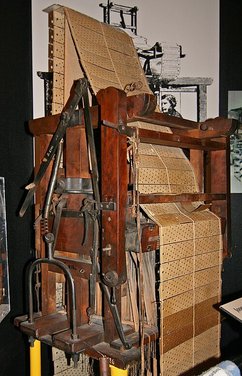
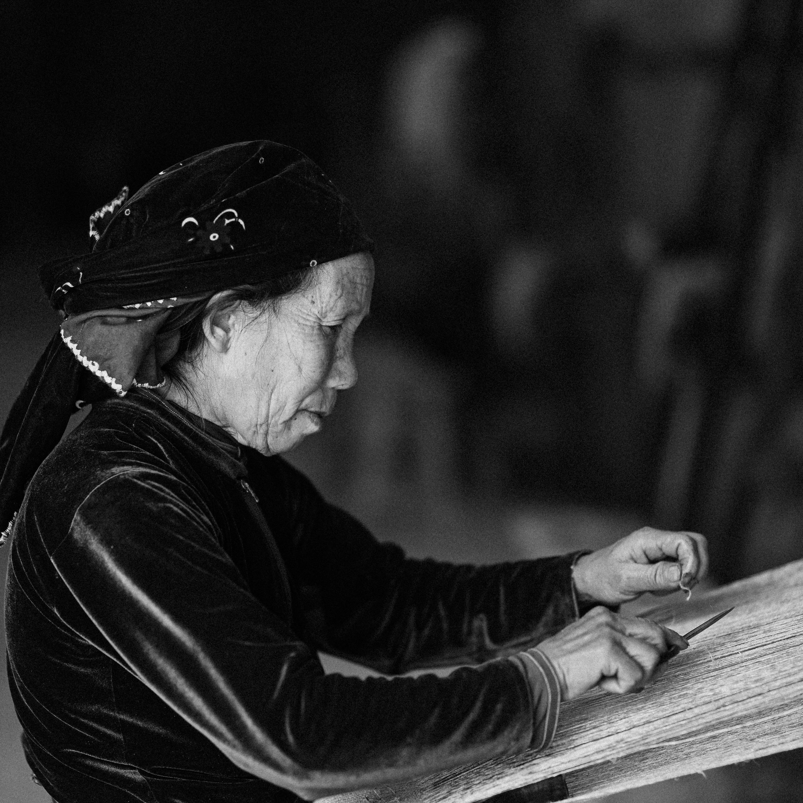
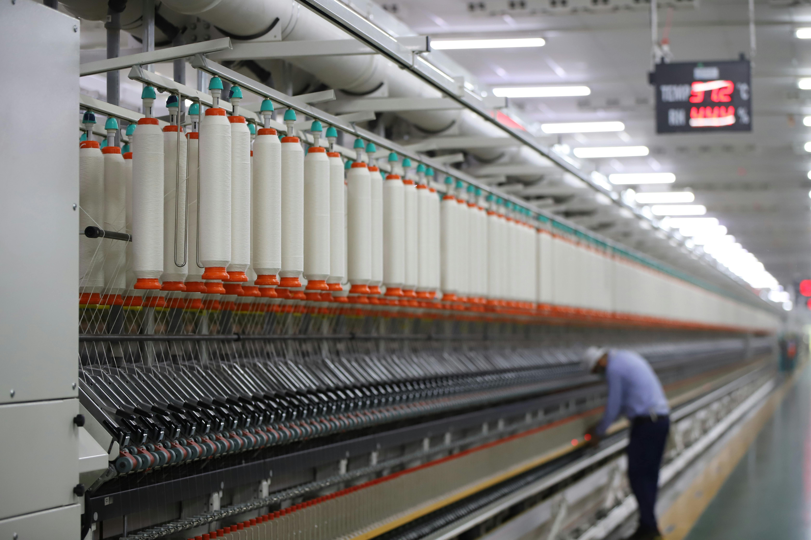

+++
date = '2025-08-27T10:00:00-04:00'
draft = false
title = 'The end of artisanal software'
tags = ['AI', 'software development', 'industry', 'history', 'programming']
slug = 'the-end-of-artisanal-software'
+++

Recently a colleague described a certain company by saying its development process was "very artisanal", and it wasn't a compliment.

# The artisanal paradox

It's curious how the same word can carry such opposite connotations. When we buy artisanal beer or artisanal furniture, we pay extra, because we expect superior quality, premium as they say these days.

Artisanal implies care, attention to detail, superior quality. Every piece is unique, made with dedication by expert hands.

Years ago the concept of ["software craftsmanship"](https://en.wikipedia.org/wiki/Software_craftsmanship) came into fashion, and it was this positive vision, a concern for the "beauty" and quality of software.

But today, in general, when someone says your software is "artisanal", they're telling you you're an amateur. That you have no processes. That you depend too much on individual talent. That you can't scale. That every project is an unpredictable adventure.

And they're right.

For decades we've tried to industrialize software development. We tried with waterfall methodologies, with RUP, with CMMI. Then came the agile methodologies, which paradoxically celebrated a certain return to the artisanal: "individuals and interactions over processes and tools".

But now, with the arrival of generative AI, we are finally entering the true industrial era of software.

# The Jacquard looms of the 21st century

In 1801, [Joseph Marie Jacquard](https://es.wikipedia.org/wiki/Joseph_Marie_Jacquard) invented a loom that could weave complex patterns automatically, controlled by punched cards. It was one of the first programmable machines in history. The artisan weavers, who had mastered the trade for centuries, suddenly found themselves competing with machines that could produce cloth faster and cheaper.

Not all of them disappeared. The best adapted. They became pattern designers, specialized operators, quality supervisors. But the trade changed forever.

Claude Code, Cursor, Copilot, and all the generative AI tools are our Jacquard looms. And we are the weavers.

In [2009 I wrote about programming as an art](/en/blog/lnds/2009/12/01/programming-as-an-art-part-i/), translating Knuth. I distinguished between the artisan, who uses his tools to serve himself, and the artist, who transcends the medium. But now we face something different: the mass industrialization of the act of coding.

# From artisans to specialized operators

The vibe coder I mentioned in earlier posts is not an artisan. He's a worker in the new software factory. He doesn't need to understand the deep fundamentals of the language, or the subtleties of algorithms. He just needs to know how to write good prompts and check that the output works.

And that's not a bad thing. Industrialization brought prosperity. More people have access to more products. The democratization of software creation means more problems will get solved, more ideas will get implemented.

But it also means that software "made by hand", line by line, with care and deep understanding, will become rarer and rarer. And like everything artisanal once industrialization arrives, it will be more expensive and reserved for specific niches.

# What we lose, what we gain

AI's defenders will tell you we lose nothing. That programmers simply move up a level, that now we can focus on architecture, on design, on the truly hard problems. That AI takes care of the tedious part.

The critics will tell you we lose deep understanding, that we're creating a generation of programmers who don't understand what they're doing, and that when the AI fails they won't know how to fix anything.

Both are right.

In the transition to the industrial era there are always losses. Tacit knowledge is lost, the intuition that comes from years of practice, the artisan's pride. But we gain productivity, accessibility, speed.

The German military in 1940, as [I mentioned in another post](/en/blog/lnds/2021/03/28/why-and-how-to-manage-knowledge/), believed it would take the Allies a generation to train "optical craftsmen" capable of matching their quality. They didn't count on the Americans industrializing the process. They didn't need craftsmen; they needed factories.

# The future is industrial, like it or not

We can resist, we can romanticize the past, we can insist that real software is written by hand. But history teaches us that industrialization is inevitable once technology allows it.

The ones who thrive will be those who understand this transition and adapt. Not as victims, but as protagonists. Those who learn to direct the machines, to design the processes, to guarantee the quality.

Because in the end, someone has to design the patterns the looms will weave. Someone has to decide what's worth building. Someone has to understand the whole system when the machines fail.

That someone may be an artisan who adapted. Or it may be someone new who never knew the old world.

The era of artisanal software is ending. Not with a bang, but with a prompt.

---

*What do you think of this transition? Are you one of those embracing the change, or one of those defending the old art? I'd like to hear your opinion. You can comment here or subscribe to my [newsletter](https://newsletter.lnds.net) (in Spanish).*
