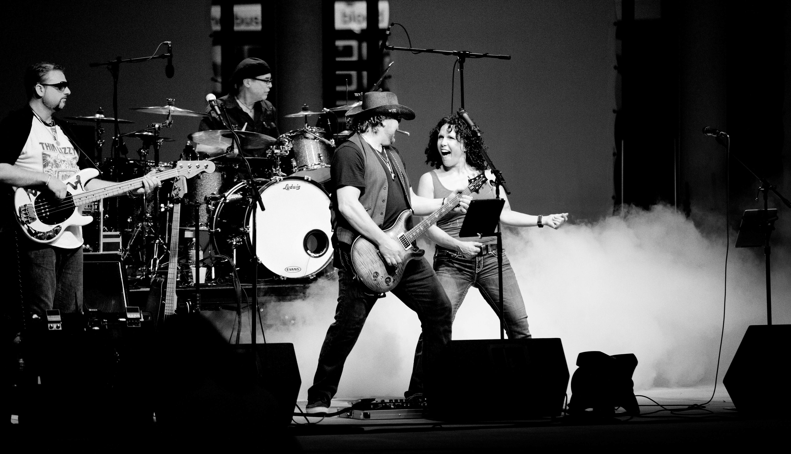

+++
title = "Agentic programming and the plotter style"
date = 2025-11-20T10:00:00-03:00
slug = "agentic-programming-plotter-style"
tags = ['AI', 'software development', 'agentic programming', 'plotters vs pantsers']
draft = false 
+++

Jorge Castaño, in [his newsletter "Vivir del Software"](https://vivirdelsoftware.substack.com/p/software-en-tiempos-de-ia-spec-driven), puts forward two interesting concepts: "spec-driven development" and "parallel programming". I found the proposal interesting, but reading it closely, it seemed to me that both concepts fall under the umbrella of what I call the **plotter** style.

To me, parallel programming with AI agents is, in essence, a way of **making the plotter style more efficient**. It's doing what people who plan before coding have always done, but with an orchestra of AIs performing the scores they wrote, to follow Castaño's metaphor.

## Plotters vs pantsers

For those who didn't read my previous post, here's a summary:

**Plotters** are the ones who plan before they execute. They design, specify, draw up roadmaps and then implement. It's the traditional engineering approach: think first, execute later.

**Pantsers** (from *by the seat of your pants*) are the ones who start coding right away, exploring the problem as they solve it. It's iterative programming, which assumes a complete specification can't be available at the start. A "lean" style.

I borrowed these concepts from the world of creative writing, where authors split between those who plan the whole plot before writing (plotters) and those who discover the story as they write it (pantsers).

In software development both styles exist and both have their place. But with the arrival of generative AI tools, these styles are being reshaped in interesting ways.

## Spec-driven development: classic plotters

Jorge defines SDD as an approach where "before writing a single line of code, the expected behavior is clearly defined in natural language". In other words: you specify everything first, and then generate code, tests and documentation from those specifications.

Sound familiar? It should. It's the decades-old dream of software engineering. The only new thing here is that we now use AI to generate the code from the specifications.

But as Jorge rightly points out, "in real life specifications change. Very often. Too often". Pure SDD "smells a bit like an old-school consulting firm, like waterfall, pure and simple".

It's a rigid approach that works well in stable, well-understood domains, but breaks down when there's uncertainty or a need to iterate fast. Because the reality is that a lot of the time we don't know exactly what we want until we see it running.

## Parallel programming: plotters with an orchestra

Jorge describes "parallel programming" as "multiple AIs or agents working in parallel on different parts of the project".

His example is revealing:

> Agent A: turns the specs into technical tasks \
> Agent B: generates the back end \
> Agent C: generates the front end \
> Agent D: writes tests \
> Agent E: writes the documentation \
> Agent F: checks that the specifications are met

Notice something crucial: **everything starts from the specifications**. There is no parallel programming without prior specifications. The agents aren't improvising, they're executing a plan.

Which means this is still 100% plotter. The difference is that now you have multiple executors working in parallel on your prior design.

As Jorge masterfully puts it: "The specifications are the score and the AIs are your orchestra. But if you don't impose order yourself, you'll get noise instead of music".

## Efficiency in the plotter approach

Here's my thesis: agentic programming doesn't change the plotter vs pantser paradigm. What it does is **make the plotter approach more efficient**.

Traditionally, the problem with being a plotter was time. Designing detailed specifications, creating architectures, defining interfaces... all of that takes time. And when things change (and they always change), you have to redesign and reimplement. All of that is expensive.

But now, with AI agents, the cost of implementation drops dramatically. If your specifications change, it's no big deal: you rewrite the spec and let the agents regenerate the code. The design-implementation-redesign cycle speeds up.

Suddenly, being a plotter isn't as expensive as it used to be. And you can iterate, and fail fast. A traditional methodology has become agile, with help from AI. That's interesting, and provocative.

## And what about the pantsers?

The question is: if we've made the waterfall approach efficient, thanks to agents, is it worth sticking with the pantser style? Are the borders between agile and traditional methods dissolving?

Jorge says you need "a human being coordinating and reviewing the code. For now this can't be delegated". Somebody has to be the conductor. And he also acknowledges that context switching can drive the conductor crazy.

The conductor needs a score. Needs specifications.

The pantser is a different kind of musician, someone more used to jam sessions. A jazz musician, and if he's a virtuoso, even better.

The plotter style is classical music, the pantser mode is rock or jazz.

Beethoven, Vivaldi, versus Dave Matthews Band or The Allman Brothers.

## The real competitive advantage

Could it be that we're facing a **forced professionalization** of software development?

Let me explain. One interesting thing we're seeing is that vibe coding, as it starts to fail, or to produce more headaches, is showing people who come from outside, or those who believe you no longer need to know how to program, that they need a method. And some discover, and others rediscover, software engineering.

What changes with AI is that speed of execution no longer seems to be the bottleneck.
The bottleneck is **clarity of thought**. How well you can specify what you want. How coherent your architecture is. How well you can coordinate multiple agents working in parallel. Everything we programmers know how to do.

In other words, AI-based software development requires knowing how to program. What a surprise!

Good plotters are going to have an edge in this new world. Because they know how to think before executing. They know how to design coherent systems. They know how to write clear specifications.

And now they have an orchestra of AIs to execute those designs at a speed that used to be impossible.

## The risks of technological optimism

But careful. As Jorge rightly warns, there's the "danger of adding infinite garbage code if you don't take charge of reviewing in depth everything the AI has generated". And he adds something that strikes me as critical: "the constant context switching can wreck your brain ahead of its time".

This is real. Having six agents working in parallel sounds great until you have to review the output of six agents, all generating code at the same time, all potentially inconsistent with each other.

The cognitive load can be brutal.

That's why I think effective agentic programming isn't just "launch a thousand agents and let them work their magic". It's a subtler art:

1. **Specify clearly** what you want (plotter mindset)
2. **Decompose intelligently** into tasks that can run in parallel
3. **Coordinate the dependencies** between agents (the front end has to wait for the back end)
4. **Review critically** the output, without assuming the AI always gets it right
5. **Iterate on the design** when you find problems in the implementation

It's a cycle. It's not "specify once and you're done". It's "specify, execute with agents, review, adjust specifications, re-execute".

Can pantsers benefit from parallel programming with agents? Of course, but they probably won't need an orchestra, just a "power trio".  

I think the pantser style, to be successful and not drift into vibe coding, or into pure improvisation, requires short iterations, deer steps, as we discussed before.
A very complex agent topology can complicate this style, because we want to be lean, remember, that's an essential principle of this style.

## The developer's new role

Jorge ends his article with a question: "new frameworks or fresh smoke?"

My answer: **neither**. They're not completely new frameworks, because the idea of specifying before implementing is as old as engineering. But it's not smoke either, because the ability to execute those specifications with multiple AI agents really is qualitatively new.

Traditional software engineering skills (design, architecture, specification) become more valuable, not less.

So, back to my initial thesis: **agentic programming is a way of making the plotter style more efficient**.

It's not a new paradigm. It's the classic approach, the conservative one if you like, of designing first and executing later, but with new tools that make the execution vastly faster.

And that changes everything. Because now being a plotter doesn't mean being slow. It means being fast AND rigorous. You can iterate quickly on well-thought-out designs.

The plotters who embrace these tools, who learn to write good specifications and to coordinate orchestras of AIs, are going to have a brutal competitive advantage.

**Tools amplify your skills**. If you're good at designing systems, AI can help you. If you have no clue about architecture, AI only helps you generate garbage faster.

One more interesting conclusion we could draw is that, with AI's support, the classic methodologies have a chance to improve and renew themselves.

If agility is in crisis, with these new scenarios and tools the "classics" have new weapons in their arsenal to defend themselves, and to criticize the agilists. The waterfall style doesn't look so bad if the stages are executed with the help of agents. An iterative, incremental method gets a boost from agents. And so on.

I find this interesting. The discussions could turn out interesting, or sterile; time will tell.

What does matter is that software engineering must renew itself and accept that AI is transforming it.

In the classic methods (plotters) as much as in the agile or lean ones (pantsers), the impact of AI is undeniable.

---

*What do you think? Are you a plotter or a pantser? How are you using (or thinking of using) AI agents in your workflow?
Could it be that the gap, and the argument over whether the classic style or the lean style is better, gets left in the past, and maybe the differences disappear with these new technologies?*

If you liked this content, I invite you to join [my Patreon](https://www.patreon.com/lnds) where we can continue the discussion.
