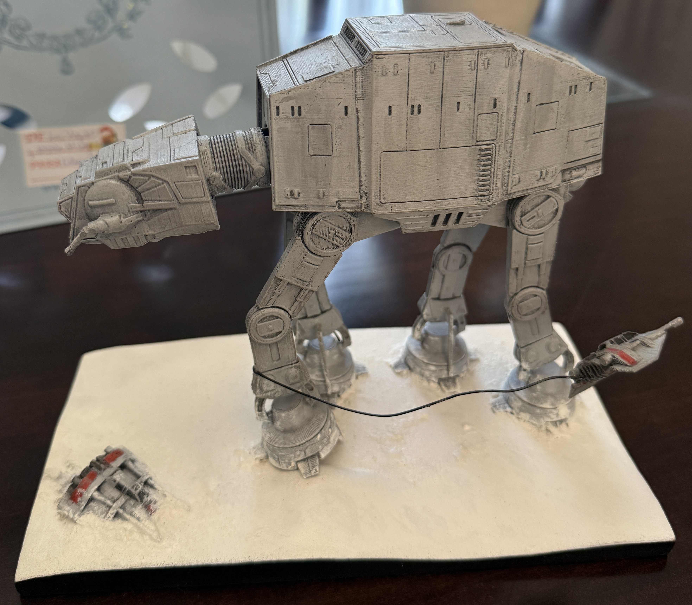
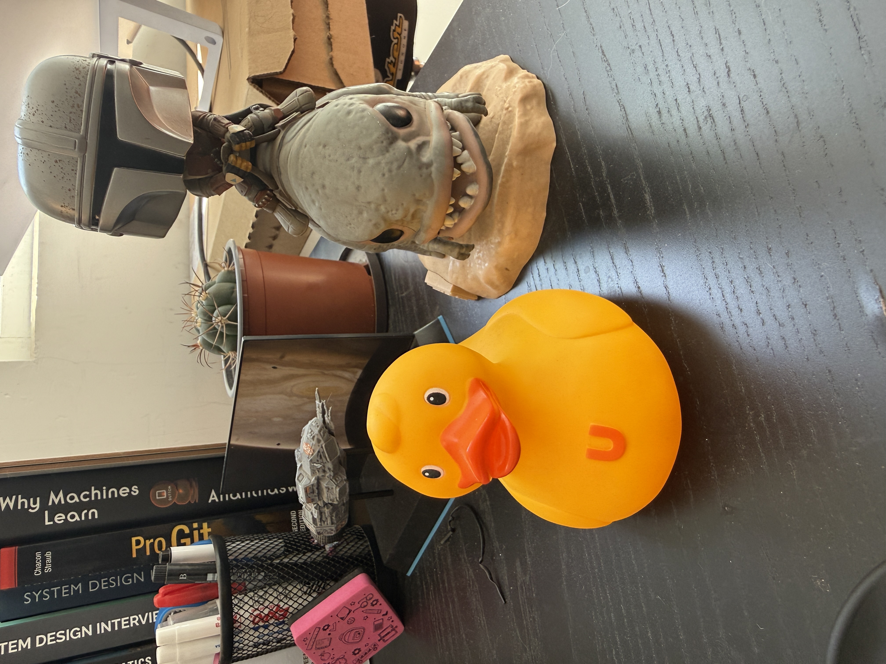
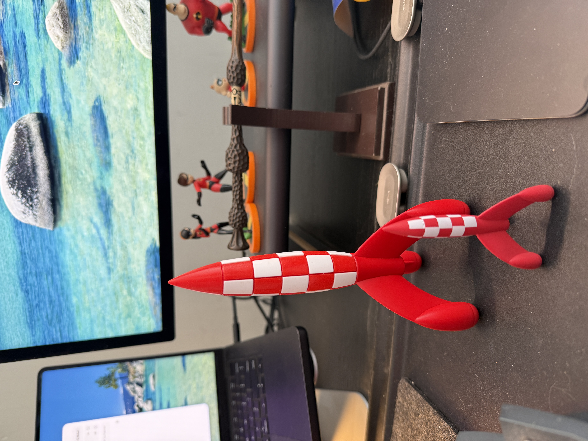

+++
date = '2025-12-25T10:00:00-03:00'
draft = false 
title = 'Toys'
slug = 'toys'
tags = ['Christmas', 'personal', 'toys']
+++

A few years ago I started a tradition: around this time of year I post photos of toys I've been collecting and that keep me company in my workspace.

The idea is for us to share in the comments those fun accessories that keep us company all year long.

This Christmas my family surprised me with this beautiful AT-AT, which I'll have to make room for on my desk.

This little duck showed up after mine went missing for a few days. Since we couldn't find it, my kids bought me this one. The problem is it seems to have asthma :D (Don't worry, my super duck turned up days after this little friend arrived).

These rockets, in the style of the comic "Tintin: Destination Moon", I picked up in Belgium during my trip to Europe this year. It's a design I've always liked, and one that had to be in my spaceship collection.

And now it's your turn. What toys decorate your desk or workplace?
I'd love for you to share them in the comments.

Merry Christmas!
