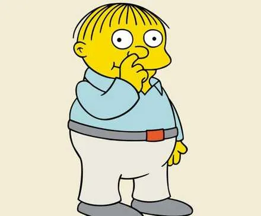

> "Me fail English? That's unpossible!"
> — Ralph Wiggum

Ralph Wiggum is the son of Springfield's police chief in the animated series The Simpsons. I'm telling you in case you've been living under a rock for the last 35 years (or never turned on a TV tuned to Canal 13 in Chile).

Little Ralph is, let's say, a special kid. His naivety borders on the absurd, but every now and then he drops a line that reveals an unexpected truth. "Me fail English? That's unpossible!" is one of his most famous: the sentence proves exactly what it denies.

It's no accident that someone decided to name a plugin for coding agents after him. [Ralph Wiggum](https://github.com/anthropics/claude-code/tree/main/plugins/ralph-wiggum) is a script that runs Claude Code in an infinite loop, feeding it AI-generated prompts, until it solves a problem or burns through the budget. The original technique comes from Geoff Huntley, who described it as "brute force exploration".

There's something poetic about this. A character who embodies accidentally brilliant incompetence, lending his name to a technique that basically says: "I don't know what I'm doing, but if I try enough times, eventually it will work".

## The voices of the apocalypse

This week I saw three tweets that, read together, paint an interesting picture.

First, Erik Meijer:



Meijer isn't just anybody. He's the creator of LINQ and Rx, and he has the academic credentials to back it up. His argument is direct: LLMs are "slop generators" (garbage), but that doesn't matter because the cost of change collapsed to zero. You no longer need the code to be perfect the first time.

Then Ryan Dahl, the creator of Node.js and Deno:



"The era of humans writing code is over." Period. Disturbing for those of us who identify as software engineers, he admits, but no less true: we will still have work to do, but writing syntax directly is not it.

And finally Grady Booch, one of the fathers of UML and of modern software engineering:



Booch offers a historical perspective: we have always raised the level of abstraction. Natural language as the next level isn't the end of the world, it's the next step in a progression that goes back to the 1950s.

Three very different voices. A pragmatic academic, an influential hacker, an industry veteran. And all three, in one way or another, agree that something fundamental is changing.

## The end is here

Meijer's thesis deserves a closer look. If the cost of change collapses, what happens to all the practices we developed to mitigate it?

Think about how much of software engineering is managing the risk of change. Code reviews, unit tests, continuous integration, decoupled architectures, documentation. All of it assumes that changing code is expensive and dangerous, that we have to get it right the first time or pay a steep price later.

But if I can regenerate the entire codebase in minutes for pocket change, why all the process?

Ralph Wiggum, the script, implements this philosophy literally. It runs `while true`, feeds prompts, evaluates results, and repeats. No elegance. No design. Just brute force and cheap tokens (assuming Claude Code's unlimited plans; otherwise it gets very expensive).

The numbers going around are absurd: six repositories solved overnight, fifty-thousand-dollar projects completed for under three hundred. If they're real, even partially, the economics of software development change.

In [The end of artisanal software](/en/blog/lnds/2025/08/27/the-end-of-artisanal-software/) I wrote about Jacquard looms. The artisan weavers also believed their craft was irreplaceable. They were right that something was being lost. But they were wrong that it would stop industrialization.

## The end as purpose

But there's another reading of the word "end". Not as the finish, but as the purpose. The aim.

What is the end of software engineering? Writing code?

In 1986, Fred Brooks wrote "No Silver Bullet", distinguishing between essential and accidental complexity. Essential complexity is inherent to the problem we're solving. Accidental complexity comes from our imperfect tools and processes.

If AI eliminates the accidental complexity of writing code, what's left is the essential complexity: understanding what to build and why.

In [Judgment and taste](/en/blog/lnds/2026/01/07/judgment-and-taste/) I quoted Joseph Weizenbaum, who distinguished between the professional programmer and the compulsive one. The professional sees programming as a means to an end. "His satisfaction comes from having solved a substantive problem, not from having bent a computer to his will."

The compulsive one programs for the sake of programming. The code is the end, not the means.

If your professional identity is tied to the act of writing code, the collapse of the cost of change is an existential threat. But if your value lies in understanding complex problems, in designing elegant solutions, in making hard decisions, then AI is one more tool.

The end of software engineering was never writing code. It was managing complexity to solve real problems.

## Neither plotter nor pantser: brute force

In [Maps or compasses](/en/blog/lnds/2025/10/31/maps-or-compasses/) I described two approaches to programming with AI: the plotters, who plan everything before writing, and the pantsers, who explore iteratively.

Ralph Wiggum is neither. It's something new.

The plugin's README says it without shame:

> "Iteration > Perfection"
> "Failures Are Data"
> "Context Is King"

There's no plan. There's no guided exploration. Just a loop that generates, evaluates, fails, and repeats. The intelligence isn't in the process, it's in the acceptance criteria.

The irony is that it seems to work.

It's uncomfortable to admit. Decades of methodologies, best practices, certifications and frameworks, and it turns out that sometimes the answer is "try a lot of things until something works".

But we shouldn't be surprised. Machine learning works that way. Evolution works that way. Science works that way, if you give it enough time.

What changed is that now we can make millions of attempts at an apparently very low cost (as long as we ignore the environmental cost of using AI).

If the "end" as the finish of software engineering arrives, if we really stop writing code as our central activity, then the "end" as purpose comes into sharp focus.

We were never code writers. We were managers of complexity, translators between the chaotic world of human problems and the formal world of computational instructions.

Obie Fernandez put it well: "Those 10,000 hours you spent becoming a great programmer aren't useless at all. They're what give you the two things that actually matter now: judgment and taste."

Judgment to know what to build. Taste to recognize when it's well made.

Ralph Wiggum, the character, has neither. He says absurd things that are accidentally profound. But he doesn't know why they're profound. He can't repeat the trick on purpose.

Ralph Wiggum, the script, has no judgment or taste either. It only has tokens and time. It needs someone to define the acceptance criteria, someone to evaluate the results, someone to decide when the problem is solved.

That someone is still you.

Or at least it is for as long as you have the judgment to tell good from bad, and the taste to prefer the elegant over the functional but ugly.

---

*The end of software engineering? Depends on which end you mean.*

*If you'd like to keep this conversation going, subscribe to my [newsletter](https://lnds.substack.com) (in Spanish) or support me on [Patreon](https://www.patreon.com/lnds).*

---

**References:**

- [Ralph Wiggum plugin (Anthropic)](https://github.com/anthropics/claude-code/tree/main/plugins/ralph-wiggum)
- [A Brief History of Ralph (HumanLayer)](https://www.humanlayer.dev/blog/brief-history-of-ralph)
- [Geoff Huntley's original technique](https://ghuntley.com/ralph/)
- [No Silver Bullet - Fred Brooks (PDF)](https://worrydream.com/refs/Brooks-NoSilverBullet.pdf)

**Related posts on this blog:**

- [The end of artisanal software](/en/blog/lnds/2025/08/27/the-end-of-artisanal-software/) (2025)
- [Judgment and taste](/en/blog/lnds/2026/01/07/judgment-and-taste/) (2026)
- [Maps or compasses](/en/blog/lnds/2025/10/31/maps-or-compasses/) (2025)
- [We are not cooks](/en/blog/lnds/2013/03/08/we-are-not-cooks/) (2013)
- [Creators of universes](/en/blog/lnds/2011/10/11/creators-of-universes/) (2011)
