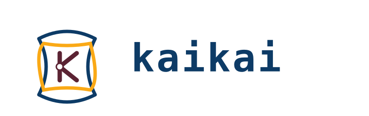

+++
date = '2026-05-21T10:00:00-03:00'
title = 'Simple programming with kaikai'
slug = "simple-programming-with-kaikai"
tags = ["kaikai", "programming languages", "functional programming", "algebraic effects", "compilers", "language design"]
draft = false
+++

> *"Simplicity is prerequisite for reliability."* — Edsger Dijkstra

In the [previous post](/en/blog/lnds/2026/05/17/method-matters-more-than-model/) I covered the method: how to build a complete compiler in a month while life goes on. But I deliberately didn't talk about the language. The reason was very simple: the month wasn't up yet. Today is the day.

I set out to build, in one month and using AI, a complete compiler for a language I've been designing for more than 10 years.
Was the experiment a success? I think so, but there are nuances and lessons that I'll leave for the next post. Sorry for telling you the whole story in installments, but first things first, and right now I want to introduce the language.

For many years I've been chewing on the idea of a general-purpose functional language that I could actually use in my personal projects and even at work (we'll see if I pull that off). In college I learned to build compilers, and I fell in love with programming language design. I've also designed domain-specific languages to solve real problems.

In 2017 I gave a talk titled "Esos raros lenguajes nuevos" ("Those weird new languages") where I explain, in an entertaining way, why there are so many programming languages; [the video is on YouTube](https://www.youtube.com/watch?v=Hp9HwLPYkjI).
That's where I introduced Ogú, a language I designed that is really a prototype of the language I'm presenting today.
The story of how I put that compiler together is written up in [Fake it till you make it](/en/blog/lnds/2017/03/01/fake-it-till-you-make-it/).

Today I'm going to show you kaikai. First let's talk about the name.

## Kaikai



Kaikai is a Rapa Nui game. According to [SIGPA](https://www.sigpa.cl/ficha-elemento/kai-kai-de-rapa-nui), Chile's intangible heritage registry:

> It is a practice in which a figure or "ideogram" is formed by interlacing strings between the fingers of the hands, with help from the mouth or feet. It is associated with a recited story called pata’u ta’u. Through this tradition, knowledge is passed on about various areas of life such as the arts, agriculture or fishing, among others.

It's the string game, cat's cradle in English, or the Japanese ayatori. But in Rapa Nui it's tied to oral tradition and poetry.

Initially I was thinking of the kai kai of Mapuche mythology, but when I discovered the Rapa Nui kaikai it clicked immediately, because it reminded me of Rich Hickey's famous talk ["Simple Made Easy"](https://www.infoq.com/presentations/Simple-Made-Easy/).

In the talk, Hickey discusses the difference between simple and complex, citing the etymological origin of the terms. At its root, "complex" means "to be braided together". "Simple", on the other hand, implies a single fold or a single strand of a braid.

And that's what kaikai is: a game in which, with just one string and through skillful, simple moves, you build complex figures.

## My first program

In the talk I mentioned, I say that the first thing I learned to program was a converter between degrees Celsius and Fahrenheit. Well, to keep up the tradition, and because it's the only thing I know how to program, here's what it would look like in kaikai:

```kaikai
# temperature converter 

unit F
unit C

const f2c : Real<F/C> = 9.0<F>/5.0<C>
const c2f : Real<C/F> = 5.0<C>/9.0<F>

fn celsius_to_fahrenheit(c : Real<C>) : Real<F> = (c * f2c) + 32.0<F>

fn fahrenheit_to_celsius(f : Real<F>) : Real<C> = (f - 32.0<F>) * c2f

fn main() {
    let c = 35.0<C>
    let f = celsius_to_fahrenheit(c)
    println("#{c} -> #{f}")
    let f = 100.0<F>
    let c = fahrenheit_to_celsius(f)
    println("#{f} -> #{c}")
  }
```

This simple program introduces several features of kaikai.

Comments start with `#`. What follows are two unit-of-measure definitions, F and C. For example, `unit F` defines the unit F, to represent degrees Fahrenheit.

This is a feature I took from F#, because it eliminates a whole pile of errors.

Think of a fintech application where you have to convert from euros to dollars: if you mix up currencies, it can be a disaster. Units of measure (UoM) extend the type system (technically they add a "kind" to the type).

If NASA had used kaikai, the [Mars Climate Orbiter](https://es.wikipedia.org/wiki/Mars_Climate_Orbiter) failure wouldn't have happened.

Apart from UoM, kaikai doesn't look very novel. But what if I told you this program is showing algebraic effects in use and you didn't even notice?

## Algebraic effects

Algebraic what?!


I don't want to scare you. It's actually a very simple concept, but one with a lot of theory behind it, and kaikai is one of the few languages that implements this feature.

In [Revelations](/en/blog/lnds/2015/10/01/revelations/) I explain, in mystical fashion, like an almost religious epiphany, that every useful program has to interact with the world. That breaks the purity functional languages promise.

The path taken by the creators of pure functional languages like Haskell was to bring in category theory: something fairly complicated that tries to encapsulate the effects that occur in a program.

When you write to the console, you're producing a side effect. When you write to the database, or when you read from the database, you're under the influence of an effect.

In that post I explained that there are 4 horsemen that affect our programs:

- Failure: your programs can fail for thousands of reasons; this is traditionally handled with exceptions (try/catch).
- Configuration: your program's behavior is affected by the configuration of the environment it's running in.
- Uncertainty: a pure function maps an input to a single output. That's known as referential transparency. But there are non-deterministic functions, because the result depends on other factors: the result of a database query, the response from an LLM, etc.
- Destruction: this is the most common kind of effect; you print to the console or to a printer, send an email, write a file, delete another one, etc.

For kaikai, all of these are effects. A `println` is an effect. Specifically, it's part of the `Stdout` effect (which in turn is part of an effect that groups them: `Io`).
Querying environment variables is part of the `Env` effect. To handle an exception you use the `Fail` effect.
For concurrency you use the `Fiber` effect or the `Actor` effect. And in other extensions outside the standard library you have things like the `Db` effect.

How do you declare an effect? Let's see:

```kaikai
effect Log {
  log(msg: String) : Unit
}
```

And you use it like this:

```kaikai
fn greet(name: String) : Unit / Log {
  Log.log("hello, " ++ name)
}

fn main() {
  handle {
    greet("kaikai")
    greet("world")
  } with Log {
    log(msg, resume) -> {
      println("[INFO] " ++ msg)
      resume(())
    }
  }
}
```

What happens here is that you must either handle the effect or declare that you're not going to handle it, and you assume whoever uses your function will.

In this example, `greet` declares that it returns nothing (type `Unit`) and that it has an effect inside (this is declared after the slash '/'). The function's signature declares that it calls an effect, but doesn't handle it.

The `main` function takes care of handling `Log` using the `handle ... with` construct.

The beautiful thing about effects is that they fold all these concepts into one. Concurrency, exceptions, logs, input/output, etc. They're all effects. You don't have to learn different concepts or distinct language constructs to handle each case.

Think of `async` in JavaScript or Rust, and other languages. One thing that happens is that when you mark a function as `async`, it contaminates the whole chain, and you have to start putting `async` or `await` everywhere; besides being uncomfortable, it starts to lose its meaning. In kaikai this is just one more effect, the syntax goes in the signature, and you handle it where it belongs, not somewhere else.

Effects can, of course, define default handlers to improve their ergonomics. That's why you can use `println` without having to write a `handle` block.

## Pipes, pipes everywhere

Kaikai has the `|>` operator from Elixir and other languages, but it also has other extensions. The `|` operator is a map, `||` is a flatmap, and `|?` is a filter. It's a whim, but a useful one.

Let's look at an example:

```kaikai
fn rango_loop(i: Int, n: Int, acc: [Int]) : [Int]
  = if i > n { list_reverse(acc) } else { rango_loop(i + 1, n, [i, ...acc]) }

fn rango(n: Int) : [Int] = rango_loop(1, n, [])

fn cuadrado(n: Int) : Int = n * n

fn divisores(n: Int) : [Int] = [1, n]

fn es_par(n: Int) : Bool = n % 2 == 0

fn main() {
  let total = rango(4)                # [1, 2, 3, 4]
    | cuadrado                        # [1, 4, 9, 16]      (map)
    || divisores                      # [1, 1, 1, 4, 1, 9, 1, 16] (flat-map)
    |? es_par                         # [4, 16]            (filter)
    |> list.sum                       # 20                 (apply)

  println("total=#{total}")
}
```

This lets you write less, and in my opinion it's sometimes clearer than writing `|> filter`.

Oh, and `|>` lets you define where the argument gets passed. For example:

```kaikai

fn foo(x: Int, y: Int, z: Int) : Int = ?

fn main() {
   2 |> foo(3, _, 4)
}
```

Here the value 2 is passed in the position indicated by `_`.

By the way, you can make your own type support pipes if you implement the `map`, `flat_map` and `filter` functions.
Pipes are a special case of a protocol.

Protocols are similar to interfaces or traits. In kaikai, protocols are closer to Go's interfaces.

One more thing: the `?` is a "hole", a feature aimed at helping AIs write kaikai code.

## Agent Friendly

Holes are a mechanism with a long history, one of the most recent proposals being the paper by Cyrus Omar, Ian Voysey, Ravi Chugh and Matthew Hammer, "Live Functional Programming with Typed Holes", from 2019.

You can define a function like this:

```kaikai
fn area_circulo(r : Real<cm>) : Real<cm> = ?area_cms_por_definir
```

Here you've left a hole named `?area_cms_por_definir` that you'll write later (or ask an agent to write for you). The program will compile and, at runtime, fail when it hits the hole.

Besides holes, kaikai helps agents by generating ergonomic errors, and you can run analyses with JSON output. It also has commands like `kai info --json`.

You can tell your agent to do this:

```
kai info syntax --json 
```

And it'll have information about kaikai's syntax (the non-JSON version is for you to read).

If you want to know about effects you run: `kai info effects`.

There are more uses for holes, and other agent-friendly features, that you can explore and learn on your own in the book.

Yes, there's a book!

## The book

Of course, the language launch includes more than the compiler. That's part of the experiment.

Kaikai comes into the world with a website, [https://kaikai-lang.org/](https://kaikai-lang.org/), and a book you can download right there (in Spanish and English).

The book was written by an agent with me acting as editor; the foreword I wrote by hand (same as this post).

It's also born with a few basic packages: [ahu](https://github.com/kaikailang-org/ahu), a framework for building concurrent applications; [kohau](https://github.com/kaikailang-org/kohau), a database driver for sqlite (and, in the future, postgres); and [henua](https://github.com/kaikailang-org/henua), a framework for building DDD applications (it implements a Repository and an EventBus).

And, of course, plugins for Neovim and Visual Studio Code (for those who are still suffering with that thing).

Yes, all of it built with agents working in parallel. But that's the third part of the story.

## What comes next?

I believe AIs and humans are going to need new languages. Right now there's a trend toward using Rust because AI makes it possible, because that language's complexities become manageable. But, in my opinion, there's room for languages as powerful as Rust but not as complicated. Kaikai has features that rival Rust's, which I can't lay out here for lack of space, but I'll get to them later.

Well, this is the official launch of kaikai. Now you have to help me, because it's not production-ready. There are several improvements still to implement, but you can already use it to experiment, create frameworks and libraries, and validate that it's possible to use kaikai in production. If you find something, or want to know whether we'll support some feature, open an issue on GitHub and I'll see what can be done.

I'm asking you to spread the word. I'll take care of promoting it among colleagues and friends, and of course in the English-speaking tech sphere too, because kaikai is for the whole world. And I think it's a novel contribution.

If you like it, you can support me by spreading the word, signing up for my [Patreon](https://www.patreon.com/lnds), or simply sharing this article.
